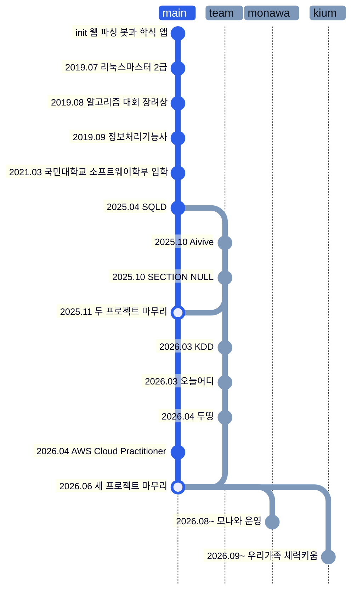

<picture>
  <source media="(max-width: 600px) and (prefers-color-scheme: dark)" srcset="https://raw.githubusercontent.com/Sangjin-kmu/Sangjin-kmu/main/assets/header-dark-m.svg?v=2">
  <source media="(max-width: 600px)" srcset="https://raw.githubusercontent.com/Sangjin-kmu/Sangjin-kmu/main/assets/header-light-m.svg?v=2">
  <source media="(prefers-color-scheme: dark)" srcset="https://raw.githubusercontent.com/Sangjin-kmu/Sangjin-kmu/main/assets/header-dark.svg?v=2">
  
</picture>

> [!NOTE]
> 지금은 혼자 만든 학식 리뷰 서비스 [모나와](https://www.monawa.site)를 운영하면서 가족 체력 서비스 우리가족 체력키움의 프론트엔드를 만들고 있습니다. 12월에는 정보처리기사 시험을 봅니다.

고등학교 때 문제 풀이로 코딩을 배우다가, 카카오톡 봇을 만들면서 직접 만드는 재미를 알았습니다. 학교 학식표를 긁어 오는 안드로이드 앱도 그때 만들었으니 학식과는 인연이 꽤 깁니다. 대학에서는 웹 팀 프로젝트마다 서버와 배포를 주로 맡았고, 화면이 필요하면 화면도 만들었습니다.

## projects/

<details open>
<summary><kbd>2026</kbd>&ensp;<b>모나와</b>&ensp;학식 리뷰 서비스, 혼자 만들고 운영 중</summary>
<br>


<br><br>

학교 식단표에는 메뉴 이름만 있어서 먹어 봐야 맛을 알 수 있었습니다. 그래서 학생들이 남긴 사진과 별점을 보고 오늘 뭘 먹을지 고르는 서비스를 만들었습니다. 기획과 디자인, 개발, 운영을 모두 혼자 합니다.

평가는 존맛, 먹을만, 노맛 중 하나를 고르면 끝나도록 가볍게 만들었습니다. 매일 아침 7시에 GitHub Actions가 학교 학식 페이지를 읽어 와 식당과 코너, 가격을 정리하고, 같은 이름의 메뉴는 하나로 합쳐서 예전에 쌓인 리뷰가 그대로 이어집니다. 방학 동안 만들어 개강 전에 열었고, 학기 중에는 매주 리뷰 추첨 이벤트를 열면서 들어오는 제보를 하나씩 처리합니다.

```yaml
period: 2026.08~ (운영 중)
team:   혼자
role:   기획, 디자인, 프론트엔드, 백엔드, 인프라
stack:  Next.js, TypeScript, Tailwind CSS, PostgreSQL(RDS),
        S3, Amplify, GitHub Actions
```

[www.monawa.site](https://www.monawa.site)&ensp;<sub>저장소는 비공개입니다.</sub>

</details>

<details>
<summary><kbd>2026</kbd>&ensp;<b>우리가족 체력키움</b>&ensp;가족 체력 웹 서비스, 개발 중</summary>
<br>


<br><br>

국민체력100 공공데이터로 아이 체력을 재고, 부모와 아이가 같이 운동을 이어 가게 만드는 서비스입니다. 국민대 알파프로젝트로 시작해 한국스포츠정책과학원 공공데이터 활용 경진대회에 냈고, 저는 프론트엔드 전체와 시연용 AWS 배포를 맡고 있습니다. 아이 홈은 three.js로 만든 3D 섬이고, 운동한 날마다 섬에 나무가 한 그루씩 자랍니다.

```yaml
period: 2026.09~ (개발 중)
team:   국민대 알파프로젝트
role:   프론트엔드, AWS 배포
stack:  Next.js, TypeScript, three.js, TanStack Query,
        Zustand, Tailwind CSS, Lightsail, CloudFront
```

[family-fitness/family-fitness-fe](https://github.com/family-fitness/family-fitness-fe)

</details>

<details>
<summary><kbd>2026</kbd>&ensp;<b>두띵</b>&ensp;동아리 굿즈 공동구매 사이트</summary>
<br>


<br><br>

동아리들은 굿즈를 만들 때 구글폼으로 주문을 받고 단톡방에서 입금을 하나하나 확인했습니다. 두띵은 굿즈 디자인과 펀딩, 입금, 제작을 한곳에서 하도록 만든 사이트이고, 제가 가장 많은 시간을 들인 프로젝트입니다.

처음 보는 다른 학과 학생 세 명이 모였고, 코딩을 할 줄 아는 사람은 저 하나였습니다. 그래서 시작하기 전에 깃허브와 AI 도구 쓰는 법을 먼저 설명하고, 깃허브 가이드와 PR 템플릿, 한국어 자동 코드 리뷰를 만들었습니다. 굿즈의 앞, 뒤, 옆 면에 직접 디자인을 올리는 에디터를 만들었고, 서버에서는 무통장입금 펀딩 주문과 마감, 알림, 관리자 기능을 맡았습니다. 화면은 S3, API는 EC2로 나눠 CloudFront 뒤에 배포했습니다. 카드 결제와 실시간 채팅, 소셜 로그인은 팀원이 만들었습니다.

```yaml
period: 2026.04~06
team:   AWS 실전 프로젝트, 3명
role:   서버, 배포, 화면
stack:  Node.js, Express, TypeScript, PostgreSQL,
        EC2, S3, CloudFront, HTML/CSS/JS
```

[AWS-PORJECT-2/AWS_PROJECT_2](https://github.com/AWS-PORJECT-2/AWS_PROJECT_2)

</details>

<details>
<summary><kbd>2026</kbd>&ensp;<b>KDD</b>&ensp;학사 규정 챗봇</summary>
<br>


<br><br>

학칙이나 규정을 물어보면 실제 문서를 인용해서 출처와 함께 답하는 챗봇입니다. 교내 학생을 대상으로 오픈베타를 했습니다. 저는 문서와 FAQ, 통계를 다루는 Spring 백엔드를 맡았고, 매일 새벽 최근 질문을 모아 FAQ 후보를 만드는 스케줄러도 넣었습니다. 화면은 Next.js로, 답을 만드는 AI 서버와 벡터 검색은 팀원들이 만들었습니다.

```yaml
period: 2026.03~06 (교내 오픈베타)
team:   4명
role:   Spring 백엔드 (문서, AI 서버 연동, FAQ, 통계)
stack:  Java 17, Spring Boot 3.4, JPA, PostgreSQL, Flyway
```

[KDD-Kookmin-Digital-Doc](https://github.com/KDD-Kookmin-Digital-Doc)

</details>

<details>
<summary><kbd>2026</kbd>&ensp;<b>오늘어디</b>&ensp;반복 경로 출발 알림</summary>
<br>


<br><br>

자주 가는 길을 한 번 등록해 두면 그날 교통 상황으로 출발 시각을 계산해서 웹 푸시로 알려 줍니다. 캡스톤디자인 수업에서 네 명이 만들었고, 저는 경로와 장소 검색, 푸시를 맡은 백엔드와 DB 스키마를 만들었습니다. 경로는 ODsay 대중교통 경로와 TMAP 보행자 경로를 이어 붙여 하나로 만듭니다. 서비스를 알리는 손그림 콘셉트의 소개 사이트도 만들었습니다.

```yaml
period: 2026.03~06
team:   캡스톤디자인, 4명
role:   백엔드 (경로, 장소 검색, 푸시), DB 스키마, 프론트 일부
stack:  Spring Boot, MySQL, Web Push, React PWA,
        ODsay, TMAP, Kakao
```

[kookmin-sw/2026-capstone-53](https://github.com/kookmin-sw/2026-capstone-53)&ensp;[소개 사이트](https://kookmin-sw.github.io/2026-capstone-53/)

</details>

<details>
<summary><kbd>2025</kbd>&ensp;<b>Aivive</b>&ensp;LLM 식단 관리 앱</summary>
<br>


<br><br>

식사와 물, 운동을 한곳에 기록하고 Gemini에게 식단 조언을 받는 안드로이드 앱입니다. 모바일프로그래밍 수업에서 세 명이 만들었고, 저는 식단 관리와 캘린더, 프로필을 맡았습니다. 모델의 답을 화면의 숫자로 쓰려고 프롬프트로 답의 형식을 정하고, 받은 값은 정규식으로 한 번 더 확인했습니다. LLM 답을 코드에서 다뤄 본 첫 프로젝트입니다.

```yaml
period: 2025.10~11
team:   모바일프로그래밍 수업, 3명
role:   식단 관리, 캘린더, 프로필
stack:  Android(Java), Room, Google Gemini
```

[tldbs0420/Team_9-MobileProgramming_2025](https://github.com/tldbs0420/Team_9-MobileProgramming_2025)

</details>

<details>
<summary><kbd>2025</kbd>&ensp;<b>SECTION NULL</b>&ensp;좀비 생존 FPS</summary>
<br>


<br><br>

Unity로 만든 좀비 생존 FPS입니다. 게임소프트웨어 수업에서 네 명이 만들어 itch.io에 올렸고, 제 첫 Unity 작업이었습니다. 아이템 파밍과 거점, 오염구역, 총기 소리를 맡았고, 최종 빌드의 화면 UI는 전부 제가 만들었습니다.

```yaml
period: 2025.10~11
team:   게임소프트웨어 수업, 4명
role:   플레이어 스탯, 아이템 파밍, 거점, 오염구역,
        인게임 UI, 사운드
stack:  Unity 6, C#, ScriptableObject, New Input System
```

[tldbs0420/Team_6-GameSoftware_2025](https://github.com/tldbs0420/Team_6-GameSoftware_2025)&ensp;[itch.io](https://ssutte.itch.io/section-null)

</details>

## skills.json

```json
{
  "role":      "Full-stack Developer",
  "frontend":  ["Next.js", "React", "three.js", "Tailwind CSS", "TanStack Query"],
  "backend":   ["Spring Boot", "JPA", "Flyway", "Node.js", "Express"],
  "database":  ["PostgreSQL", "MySQL", "Room"],
  "cloud":     ["AWS EC2", "S3", "CloudFront", "RDS", "Amplify", "Lightsail", "GitHub Actions"],
  "languages": ["Java", "JavaScript", "TypeScript", "Python", "C++", "C#", "SQL"],
  "tools":     ["Git", "Docker", "Android", "Unity"],
  "ai_tools":  ["Claude Code", "Codex", "오픈클로", "Stable Diffusion(로컬)", "Gemini"],
  "certs":     ["AWS Cloud Practitioner", "SQLD", "리눅스마스터 2급", "정보처리기능사"]
}
```

## journey.log



<picture>
  <source media="(prefers-color-scheme: dark)" srcset="https://raw.githubusercontent.com/Sangjin-kmu/Sangjin-kmu/output/snake-dark.svg">
  
</picture>

## kookmin.geojson

서울 성북구 정릉동. 2021년 소프트웨어 특기자전형으로 입학했고, 2027년 2월에 졸업할 예정입니다.

```geojson
{
  "type": "FeatureCollection",
  "features": [
    {
      "type": "Feature",
      "properties": {
        "name": "국민대학교",
        "description": "소프트웨어학부, 2021.03 입학"
      },
      "geometry": {
        "type": "Point",
        "coordinates": [
          126.997,
          37.6106
        ]
      }
    },
    {
      "type": "Feature",
      "properties": {
        "stroke": "#2c5ee8",
        "stroke-width": 2,
        "fill": "#2c5ee8",
        "fill-opacity": 0.08
      },
      "geometry": {
        "type": "Polygon",
        "coordinates": [
          [
            [
              127.000969,
              37.6106
            ],
            [
              127.000935,
              37.611013
            ],
            [
              127.000834,
              37.611419
            ],
            [
              127.000667,
              37.611812
            ],
            [
              127.000437,
              37.612183
            ],
            [
              127.000149,
              37.612528
            ],
            [
              126.999806,
              37.612839
            ],
            [
              126.999416,
              37.613112
            ],
            [
              126.998984,
              37.613342
            ],
            [
              126.998519,
              37.613525
            ],
            [
              126.998027,
              37.613658
            ],
            [
              126.997518,
              37.613739
            ],
            [
              126.997,
              37.613766
            ],
            [
              126.996482,
              37.613739
            ],
            [
              126.995973,
              37.613658
            ],
            [
              126.995481,
              37.613525
            ],
            [
              126.995016,
              37.613342
            ],
            [
              126.994584,
              37.613112
            ],
            [
              126.994194,
              37.612839
            ],
            [
              126.993851,
              37.612528
            ],
            [
              126.993563,
              37.612183
            ],
            [
              126.993333,
              37.611812
            ],
            [
              126.993166,
              37.611419
            ],
            [
              126.993065,
              37.611013
            ],
            [
              126.993031,
              37.6106
            ],
            [
              126.993065,
              37.610187
            ],
            [
              126.993166,
              37.609781
            ],
            [
              126.993333,
              37.609388
            ],
            [
              126.993563,
              37.609017
            ],
            [
              126.993851,
              37.608672
            ],
            [
              126.994194,
              37.608361
            ],
            [
              126.994584,
              37.608088
            ],
            [
              126.995016,
              37.607858
            ],
            [
              126.995481,
              37.607675
            ],
            [
              126.995973,
              37.607542
            ],
            [
              126.996482,
              37.607461
            ],
            [
              126.997,
              37.607434
            ],
            [
              126.997518,
              37.607461
            ],
            [
              126.998027,
              37.607542
            ],
            [
              126.998519,
              37.607675
            ],
            [
              126.998984,
              37.607858
            ],
            [
              126.999416,
              37.608088
            ],
            [
              126.999806,
              37.608361
            ],
            [
              127.000149,
              37.608672
            ],
            [
              127.000437,
              37.609017
            ],
            [
              127.000667,
              37.609388
            ],
            [
              127.000834,
              37.609781
            ],
            [
              127.000935,
              37.610187
            ],
            [
              127.000969,
              37.6106
            ]
          ]
        ]
      }
    }
  ]
}
```

## nameplate.stl

책상에 세워 두는 편집기 창 모양 명패입니다. 이름은 Pretendard Bold 글자 윤곽을 파이썬으로 세워 만들었습니다.

```stl
solid nameplate
facet normal 0 0.98 0.17
outer loop
vertex -37.63 -3.94 2.49
vertex 37.63 -3.94 2.49
vertex 38.8 -3.91 2.65
endloop
endfacet
facet normal 0 0.98 0.17
outer loop
vertex -37.63 0 1.8
vertex 38.8 0.03 1.95
vertex 37.63 0 1.8
endloop
endfacet
facet normal 0 0.98 0.17
outer loop
vertex -37.63 -3.94 2.49
vertex 38.8 -3.91 2.65
vertex 39.88 -3.83 3.09
endloop
endfacet
facet normal 0 0.98 0.17
outer loop
vertex -37.63 0 1.8
vertex 39.88 0.1 2.39
vertex 38.8 0.03 1.95
endloop
endfacet
facet normal 0 0.98 0.17
outer loop
vertex -37.63 -3.94 2.49
vertex 39.88 -3.83 3.09
vertex 40.81 -3.71 3.79
endloop
endfacet
facet normal 0 0.98 0.17
outer loop
vertex -37.63 0 1.8
vertex 40.81 0.23 3.1
vertex 39.88 0.1 2.39
endloop
endfacet
facet normal 0 0.98 0.17
outer loop
vertex -37.63 -3.94 2.49
vertex 40.81 -3.71 3.79
vertex 41.53 -3.55 4.71
endloop
endfacet
facet normal 0 0.98 0.17
outer loop
vertex -37.63 0 1.8
vertex 41.53 0.39 4.02
vertex 40.81 0.23 3.1
endloop
endfacet
facet normal 0 0.98 0.17
outer loop
vertex -37.63 -3.94 2.49
vertex 41.53 -3.55 4.71
vertex 41.98 -3.36 5.78
endloop
endfacet
facet normal 0 0.98 0.17
outer loop
vertex -37.63 0 1.8
vertex 41.98 0.58 5.08
vertex 41.53 0.39 4.02
endloop
endfacet
facet normal 0 0.98 0.17
outer loop
vertex -37.63 -3.94 2.49
vertex 41.98 -3.36 5.78
vertex 42.13 -3.16 6.93
endloop
endfacet
facet normal 0 0.98 0.17
outer loop
vertex -37.63 0 1.8
vertex 42.13 0.78 6.23
vertex 41.98 0.58 5.08
endloop
endfacet
facet normal 0 0.98 0.17
outer loop
vertex -37.63 -3.94 2.49
vertex 42.13 -3.16 6.93
vertex 42.13 4.06 47.89
endloop
endfacet
facet normal 0 0.98 0.17
outer loop
vertex -37.63 0 1.8
vertex 42.13 8 47.19
vertex 42.13 0.78 6.23
endloop
endfacet
facet normal 0 0.98 0.17
outer loop
vertex -37.63 -3.94 2.49
vertex 42.13 4.06 47.89
vertex 41.98 4.27 49.04
endloop
endfacet
facet normal 0 0.98 0.17
outer loop
vertex -37.63 0 1.8
vertex 41.98 8.21 48.34
vertex 42.13 8 47.19
endloop
endfacet
facet normal 0 0.98 0.17
outer loop
vertex -37.63 -3.94 2.49
vertex 41.98 4.27 49.04
vertex 41.53 4.46 50.1
endloop
endfacet
facet normal 0 0.98 0.17
outer loop
vertex -37.63 0 1.8
vertex 41.53 8.39 49.41
vertex 41.98 8.21 48.34
endloop
endfacet
facet normal 0 0.98 0.17
outer loop
vertex -37.63 -3.94 2.49
vertex 41.53 4.46 50.1
vertex 40.81 4.62 51.02
endloop
endfacet
facet normal 0 0.98 0.17
outer loop
vertex -37.63 0 1.8
vertex 40.81 8.56 50.33
vertex 41.53 8.39 49.41
endloop
endfacet
facet normal 0 0.98 0.17
outer loop
vertex -37.63 -3.94 2.49
vertex 40.81 4.62 51.02
vertex 39.88 4.74 51.73
endloop
endfacet
facet normal 0 0.98 0.17
outer loop
vertex -37.63 0 1.8
vertex 39.88 8.68 51.03
vertex 40.81 8.56 50.33
endloop
endfacet
facet normal 0 0.98 0.17
outer loop
vertex -37.63 -3.94 2.49
vertex 39.88 4.74 51.73
vertex 38.8 4.82 52.17
endloop
endfacet
facet normal 0 0.98 0.17
outer loop
vertex -37.63 0 1.8
vertex 38.8 8.76 51.47
vertex 39.88 8.68 51.03
endloop
endfacet
facet normal 0 0.98 0.17
outer loop
vertex -37.63 -3.94 2.49
vertex 38.8 4.82 52.17
vertex 37.63 4.85 52.32
endloop
endfacet
facet normal 0 0.98 0.17
outer loop
vertex -37.63 0 1.8
vertex 37.63 8.79 51.63
vertex 38.8 8.76 51.47
endloop
endfacet
facet normal 0 0.98 0.17
outer loop
vertex -37.63 -3.94 2.49
vertex 37.63 4.85 52.32
vertex -37.63 4.85 52.32
endloop
endfacet
facet normal 0 0.98 0.17
outer loop
vertex -37.63 0 1.8
vertex -37.63 8.79 51.63
vertex 37.63 8.79 51.63
endloop
endfacet
facet normal 0 0.98 0.17
outer loop
vertex -37.63 -3.94 2.49
vertex -37.63 4.85 52.32
vertex -38.8 4.82 52.17
endloop
endfacet
facet normal 0 0.98 0.17
outer loop
vertex -37.63 0 1.8
vertex -38.8 8.76 51.47
vertex -37.63 8.79 51.63
endloop
endfacet
facet normal 0 0.98 0.17
outer loop
vertex -37.63 -3.94 2.49
vertex -38.8 4.82 52.17
vertex -39.88 4.74 51.73
endloop
endfacet
facet normal 0 0.98 0.17
outer loop
vertex -37.63 0 1.8
vertex -39.88 8.68 51.03
vertex -38.8 8.76 51.47
endloop
endfacet
facet normal 0 0.98 0.17
outer loop
vertex -37.63 -3.94 2.49
vertex -39.88 4.74 51.73
vertex -40.81 4.62 51.02
endloop
endfacet
facet normal 0 0.98 0.17
outer loop
vertex -37.63 0 1.8
vertex -40.81 8.56 50.33
vertex -39.88 8.68 51.03
endloop
endfacet
facet normal 0 0.98 0.17
outer loop
vertex -37.63 -3.94 2.49
vertex -40.81 4.62 51.02
vertex -41.53 4.46 50.1
endloop
endfacet
facet normal 0 0.98 0.17
outer loop
vertex -37.63 0 1.8
vertex -41.53 8.39 49.41
vertex -40.81 8.56 50.33
endloop
endfacet
facet normal 0 0.98 0.17
outer loop
vertex -37.63 -3.94 2.49
vertex -41.53 4.46 50.1
vertex -41.98 4.27 49.04
endloop
endfacet
facet normal 0 0.98 0.17
outer loop
vertex -37.63 0 1.8
vertex -41.98 8.21 48.34
vertex -41.53 8.39 49.41
endloop
endfacet
facet normal 0 0.98 0.17
outer loop
vertex -37.63 -3.94 2.49
vertex -41.98 4.27 49.04
vertex -42.13 4.06 47.89
endloop
endfacet
facet normal 0 0.98 0.17
outer loop
vertex -37.63 0 1.8
vertex -42.13 8 47.19
vertex -41.98 8.21 48.34
endloop
endfacet
facet normal 0 0.98 0.17
outer loop
vertex -37.63 -3.94 2.49
vertex -42.13 4.06 47.89
vertex -42.13 -3.16 6.93
endloop
endfacet
facet normal 0 0.98 0.17
outer loop
vertex -37.63 0 1.8
vertex -42.13 0.78 6.23
vertex -42.13 8 47.19
endloop
endfacet
facet normal 0 0.98 0.17
outer loop
vertex -37.63 -3.94 2.49
vertex -42.13 -3.16 6.93
vertex -41.98 -3.36 5.78
endloop
endfacet
facet normal 0 0.98 0.17
outer loop
vertex -37.63 0 1.8
vertex -41.98 0.58 5.08
vertex -42.13 0.78 6.23
endloop
endfacet
facet normal 0 0.98 0.17
outer loop
vertex -37.63 -3.94 2.49
vertex -41.98 -3.36 5.78
vertex -41.53 -3.55 4.71
endloop
endfacet
facet normal 0 0.98 0.17
outer loop
vertex -37.63 0 1.8
vertex -41.53 0.39 4.02
vertex -41.98 0.58 5.08
endloop
endfacet
facet normal 0 0.98 0.17
outer loop
vertex -37.63 -3.94 2.49
vertex -41.53 -3.55 4.71
vertex -40.81 -3.71 3.79
endloop
endfacet
facet normal 0 0.98 0.17
outer loop
vertex -37.63 0 1.8
vertex -40.81 0.23 3.1
vertex -41.53 0.39 4.02
endloop
endfacet
facet normal 0 0.98 0.17
outer loop
vertex -37.63 -3.94 2.49
vertex -40.81 -3.71 3.79
vertex -39.88 -3.83 3.09
endloop
endfacet
facet normal 0 0.98 0.17
outer loop
vertex -37.63 0 1.8
vertex -39.88 0.1 2.39
vertex -40.81 0.23 3.1
endloop
endfacet
facet normal 0 0.98 0.17
outer loop
vertex -39.88 -3.83 3.09
vertex -38.8 -3.91 2.65
vertex -37.63 -3.94 2.49
endloop
endfacet
facet normal 0 0.98 0.17
outer loop
vertex -39.88 0.1 2.39
vertex -37.63 0 1.8
vertex -38.8 0.03 1.95
endloop
endfacet
facet normal 0.13 0.17 0.98
outer loop
vertex 37.63 0 1.8
vertex 38.8 0.03 1.95
vertex 38.8 -3.91 2.65
endloop
endfacet
facet normal 0.13 0.17 0.98
outer loop
vertex 37.63 0 1.8
vertex 38.8 -3.91 2.65
vertex 37.63 -3.94 2.49
endloop
endfacet
facet normal 0.38 0.16 0.91
outer loop
vertex 38.8 0.03 1.95
vertex 39.88 0.1 2.39
vertex 39.88 -3.83 3.09
endloop
endfacet
facet normal 0.38 0.16 0.91
outer loop
vertex 38.8 0.03 1.95
vertex 39.88 -3.83 3.09
vertex 38.8 -3.91 2.65
endloop
endfacet
facet normal 0.61 0.14 0.78
outer loop
vertex 39.88 0.1 2.39
vertex 40.81 0.23 3.1
vertex 40.81 -3.71 3.79
endloop
endfacet
facet normal 0.61 0.14 0.78
outer loop
vertex 39.88 0.1 2.39
vertex 40.81 -3.71 3.79
vertex 39.88 -3.83 3.09
endloop
endfacet
facet normal 0.79 0.11 0.6
outer loop
vertex 40.81 0.23 3.1
vertex 41.53 0.39 4.02
vertex 41.53 -3.55 4.71
endloop
endfacet
facet normal 0.79 0.11 0.6
outer loop
vertex 40.81 0.23 3.1
vertex 41.53 -3.55 4.71
vertex 40.81 -3.71 3.79
endloop
endfacet
facet normal 0.92 0.07 0.38
outer loop
vertex 41.53 0.39 4.02
vertex 41.98 0.58 5.08
vertex 41.98 -3.36 5.78
endloop
endfacet
facet normal 0.92 0.07 0.38
outer loop
vertex 41.53 0.39 4.02
vertex 41.98 -3.36 5.78
vertex 41.53 -3.55 4.71
endloop
endfacet
facet normal 0.99 0.02 0.13
outer loop
vertex 41.98 0.58 5.08
vertex 42.13 0.78 6.23
vertex 42.13 -3.16 6.93
endloop
endfacet
facet normal 0.99 0.02 0.13
outer loop
vertex 41.98 0.58 5.08
vertex 42.13 -3.16 6.93
vertex 41.98 -3.36 5.78
endloop
endfacet
facet normal 1 0 0
outer loop
vertex 42.13 0.78 6.23
vertex 42.13 8 47.19
vertex 42.13 4.06 47.89
endloop
endfacet
facet normal 1 0 0
outer loop
vertex 42.13 0.78 6.23
vertex 42.13 4.06 47.89
vertex 42.13 -3.16 6.93
endloop
endfacet
facet normal 0.99 0.02 0.13
outer loop
vertex 42.13 8 47.19
vertex 41.98 8.21 48.34
vertex 41.98 4.27 49.04
endloop
endfacet
facet normal 0.99 0.02 0.13
outer loop
vertex 42.13 8 47.19
vertex 41.98 4.27 49.04
vertex 42.13 4.06 47.89
endloop
endfacet
facet normal 0.92 0.07 0.38
outer loop
vertex 41.98 8.21 48.34
vertex 41.53 8.39 49.41
vertex 41.53 4.46 50.1
endloop
endfacet
facet normal 0.92 0.07 0.38
outer loop
vertex 41.98 8.21 48.34
vertex 41.53 4.46 50.1
vertex 41.98 4.27 49.04
endloop
endfacet
facet normal 0.79 0.11 0.6
outer loop
vertex 41.53 8.39 49.41
vertex 40.81 8.56 50.33
vertex 40.81 4.62 51.02
endloop
endfacet
facet normal 0.79 0.11 0.6
outer loop
vertex 41.53 8.39 49.41
vertex 40.81 4.62 51.02
vertex 41.53 4.46 50.1
endloop
endfacet
facet normal 0.61 0.14 0.78
outer loop
vertex 40.81 8.56 50.33
vertex 39.88 8.68 51.03
vertex 39.88 4.74 51.73
endloop
endfacet
facet normal 0.61 0.14 0.78
outer loop
vertex 40.81 8.56 50.33
vertex 39.88 4.74 51.73
vertex 40.81 4.62 51.02
endloop
endfacet
facet normal 0.38 0.16 0.91
outer loop
vertex 39.88 8.68 51.03
vertex 38.8 8.76 51.47
vertex 38.8 4.82 52.17
endloop
endfacet
facet normal 0.38 0.16 0.91
outer loop
vertex 39.88 8.68 51.03
vertex 38.8 4.82 52.17
vertex 39.88 4.74 51.73
endloop
endfacet
facet normal 0.13 0.17 0.98
outer loop
vertex 38.8 8.76 51.47
vertex 37.63 8.79 51.63
vertex 37.63 4.85 52.32
endloop
endfacet
facet normal 0.13 0.17 0.98
outer loop
vertex 38.8 8.76 51.47
vertex 37.63 4.85 52.32
vertex 38.8 4.82 52.17
endloop
endfacet
facet normal 0 0.17 0.98
outer loop
vertex 37.63 8.79 51.63
vertex -37.63 8.79 51.63
vertex -37.63 4.85 52.32
endloop
endfacet
facet normal 0 0.17 0.98
outer loop
vertex 37.63 8.79 51.63
vertex -37.63 4.85 52.32
vertex 37.63 4.85 52.32
endloop
endfacet
facet normal 0.13 0.17 0.98
outer loop
vertex -37.63 8.79 51.63
vertex -38.8 8.76 51.47
vertex -38.8 4.82 52.17
endloop
endfacet
facet normal 0.13 0.17 0.98
outer loop
vertex -37.63 8.79 51.63
vertex -38.8 4.82 52.17
vertex -37.63 4.85 52.32
endloop
endfacet
facet normal 0.38 0.16 0.91
outer loop
vertex -38.8 8.76 51.47
vertex -39.88 8.68 51.03
vertex -39.88 4.74 51.73
endloop
endfacet
facet normal 0.38 0.16 0.91
outer loop
vertex -38.8 8.76 51.47
vertex -39.88 4.74 51.73
vertex -38.8 4.82 52.17
endloop
endfacet
facet normal 0.61 0.14 0.78
outer loop
vertex -39.88 8.68 51.03
vertex -40.81 8.56 50.33
vertex -40.81 4.62 51.02
endloop
endfacet
facet normal 0.61 0.14 0.78
outer loop
vertex -39.88 8.68 51.03
vertex -40.81 4.62 51.02
vertex -39.88 4.74 51.73
endloop
endfacet
facet normal 0.79 0.11 0.6
outer loop
vertex -40.81 8.56 50.33
vertex -41.53 8.39 49.41
vertex -41.53 4.46 50.1
endloop
endfacet
facet normal 0.79 0.11 0.6
outer loop
vertex -40.81 8.56 50.33
vertex -41.53 4.46 50.1
vertex -40.81 4.62 51.02
endloop
endfacet
facet normal 0.92 0.07 0.38
outer loop
vertex -41.53 8.39 49.41
vertex -41.98 8.21 48.34
vertex -41.98 4.27 49.04
endloop
endfacet
facet normal 0.92 0.07 0.38
outer loop
vertex -41.53 8.39 49.41
vertex -41.98 4.27 49.04
vertex -41.53 4.46 50.1
endloop
endfacet
facet normal 0.99 0.02 0.13
outer loop
vertex -41.98 8.21 48.34
vertex -42.13 8 47.19
vertex -42.13 4.06 47.89
endloop
endfacet
facet normal 0.99 0.02 0.13
outer loop
vertex -41.98 8.21 48.34
vertex -42.13 4.06 47.89
vertex -41.98 4.27 49.04
endloop
endfacet
facet normal -1 0 0
outer loop
vertex -42.13 8 47.19
vertex -42.13 0.78 6.23
vertex -42.13 -3.16 6.93
endloop
endfacet
facet normal -1 0 0
outer loop
vertex -42.13 8 47.19
vertex -42.13 -3.16 6.93
vertex -42.13 4.06 47.89
endloop
endfacet
facet normal 0.99 0.02 0.13
outer loop
vertex -42.13 0.78 6.23
vertex -41.98 0.58 5.08
vertex -41.98 -3.36 5.78
endloop
endfacet
facet normal 0.99 0.02 0.13
outer loop
vertex -42.13 0.78 6.23
vertex -41.98 -3.36 5.78
vertex -42.13 -3.16 6.93
endloop
endfacet
facet normal 0.92 0.07 0.38
outer loop
vertex -41.98 0.58 5.08
vertex -41.53 0.39 4.02
vertex -41.53 -3.55 4.71
endloop
endfacet
facet normal 0.92 0.07 0.38
outer loop
vertex -41.98 0.58 5.08
vertex -41.53 -3.55 4.71
vertex -41.98 -3.36 5.78
endloop
endfacet
facet normal 0.79 0.11 0.6
outer loop
vertex -41.53 0.39 4.02
vertex -40.81 0.23 3.1
vertex -40.81 -3.71 3.79
endloop
endfacet
facet normal 0.79 0.11 0.6
outer loop
vertex -41.53 0.39 4.02
vertex -40.81 -3.71 3.79
vertex -41.53 -3.55 4.71
endloop
endfacet
facet normal 0.61 0.14 0.78
outer loop
vertex -40.81 0.23 3.1
vertex -39.88 0.1 2.39
vertex -39.88 -3.83 3.09
endloop
endfacet
facet normal 0.61 0.14 0.78
outer loop
vertex -40.81 0.23 3.1
vertex -39.88 -3.83 3.09
vertex -40.81 -3.71 3.79
endloop
endfacet
facet normal 0.38 0.16 0.91
outer loop
vertex -39.88 0.1 2.39
vertex -38.8 0.03 1.95
vertex -38.8 -3.91 2.65
endloop
endfacet
facet normal 0.38 0.16 0.91
outer loop
vertex -39.88 0.1 2.39
vertex -38.8 -3.91 2.65
vertex -39.88 -3.83 3.09
endloop
endfacet
facet normal 0.13 0.17 0.98
outer loop
vertex -38.8 0.03 1.95
vertex -37.63 0 1.8
vertex -37.63 -3.94 2.49
endloop
endfacet
facet normal 0.13 0.17 0.98
outer loop
vertex -38.8 0.03 1.95
vertex -37.63 -3.94 2.49
vertex -38.8 -3.91 2.65
endloop
endfacet
facet normal 0 0.17 0.98
outer loop
vertex -37.63 0 1.8
vertex 37.63 0 1.8
vertex 37.63 -3.94 2.49
endloop
endfacet
facet normal 0 0.17 0.98
outer loop
vertex -37.63 0 1.8
vertex 37.63 -3.94 2.49
vertex -37.63 -3.94 2.49
endloop
endfacet
facet normal 0 0.98 0.17
outer loop
vertex -37.73 2.1 43.66
vertex 37.73 2.1 43.66
vertex 38.57 2.13 43.83
endloop
endfacet
facet normal 0 0.98 0.17
outer loop
vertex -37.73 3.28 43.46
vertex 38.57 3.31 43.62
vertex 37.73 3.28 43.46
endloop
endfacet
facet normal 0 0.98 0.17
outer loop
vertex -37.73 2.1 43.66
vertex 38.57 2.13 43.83
vertex 39.29 2.21 44.3
endloop
endfacet
facet normal 0 0.98 0.17
outer loop
vertex -37.73 3.28 43.46
vertex 39.29 3.4 44.09
vertex 38.57 3.31 43.62
endloop
endfacet
facet normal 0 0.98 0.17
outer loop
vertex -37.73 2.1 43.66
vertex 39.29 2.21 44.3
vertex 39.76 2.34 45
endloop
endfacet
facet normal 0 0.98 0.17
outer loop
vertex -37.73 3.28 43.46
vertex 39.76 3.52 44.79
vertex 39.29 3.4 44.09
endloop
endfacet
facet normal 0 0.98 0.17
outer loop
vertex -37.73 2.1 43.66
vertex 39.76 2.34 45
vertex 39.93 2.48 45.83
endloop
endfacet
facet normal 0 0.98 0.17
outer loop
vertex -37.73 3.28 43.46
vertex 39.93 3.67 45.62
vertex 39.76 3.52 44.79
endloop
endfacet
facet normal 0 0.98 0.17
outer loop
vertex -37.73 2.1 43.66
vertex 39.93 2.48 45.83
vertex 39.93 2.9 48.19
endloop
endfacet
facet normal 0 0.98 0.17
outer loop
vertex -37.73 3.28 43.46
vertex 39.93 4.08 47.99
vertex 39.93 3.67 45.62
endloop
endfacet
facet normal 0 0.98 0.17
outer loop
vertex -37.73 2.1 43.66
vertex 39.93 2.9 48.19
vertex 39.76 3.05 49.02
endloop
endfacet
facet normal 0 0.98 0.17
outer loop
vertex -37.73 3.28 43.46
vertex 39.76 4.23 48.82
vertex 39.93 4.08 47.99
endloop
endfacet
facet normal 0 0.98 0.17
outer loop
vertex -37.73 2.1 43.66
vertex 39.76 3.05 49.02
vertex 39.29 3.17 49.73
endloop
endfacet
facet normal 0 0.98 0.17
outer loop
vertex -37.73 3.28 43.46
vertex 39.29 4.35 49.52
vertex 39.76 4.23 48.82
endloop
endfacet
facet normal 0 0.98 0.17
outer loop
vertex -37.73 2.1 43.66
vertex 39.29 3.17 49.73
vertex 38.57 3.25 50.2
endloop
endfacet
facet normal 0 0.98 0.17
outer loop
vertex -37.73 3.28 43.46
vertex 38.57 4.44 49.99
vertex 39.29 4.35 49.52
endloop
endfacet
facet normal 0 0.98 0.17
outer loop
vertex -37.73 2.1 43.66
vertex 38.57 3.25 50.2
vertex 37.73 3.28 50.36
endloop
endfacet
facet normal 0 0.98 0.17
outer loop
vertex -37.73 3.28 43.46
vertex 37.73 4.46 50.15
vertex 38.57 4.44 49.99
endloop
endfacet
facet normal 0 0.98 0.17
outer loop
vertex -37.73 2.1 43.66
vertex 37.73 3.28 50.36
vertex -37.73 3.28 50.36
endloop
endfacet
facet normal 0 0.98 0.17
outer loop
vertex -37.73 3.28 43.46
vertex -37.73 4.46 50.15
vertex 37.73 4.46 50.15
endloop
endfacet
facet normal 0 0.98 0.17
outer loop
vertex -37.73 2.1 43.66
vertex -37.73 3.28 50.36
vertex -38.57 3.25 50.2
endloop
endfacet
facet normal 0 0.98 0.17
outer loop
vertex -37.73 3.28 43.46
vertex -38.57 4.44 49.99
vertex -37.73 4.46 50.15
endloop
endfacet
facet normal 0 0.98 0.17
outer loop
vertex -37.73 2.1 43.66
vertex -38.57 3.25 50.2
vertex -39.29 3.17 49.73
endloop
endfacet
facet normal 0 0.98 0.17
outer loop
vertex -37.73 3.28 43.46
vertex -39.29 4.35 49.52
vertex -38.57 4.44 49.99
endloop
endfacet
facet normal 0 0.98 0.17
outer loop
vertex -37.73 2.1 43.66
vertex -39.29 3.17 49.73
vertex -39.76 3.05 49.02
endloop
endfacet
facet normal 0 0.98 0.17
outer loop
vertex -37.73 3.28 43.46
vertex -39.76 4.23 48.82
vertex -39.29 4.35 49.52
endloop
endfacet
facet normal 0 0.98 0.17
outer loop
vertex -37.73 2.1 43.66
vertex -39.76 3.05 49.02
vertex -39.93 2.9 48.19
endloop
endfacet
facet normal 0 0.98 0.17
outer loop
vertex -37.73 3.28 43.46
vertex -39.93 4.08 47.99
vertex -39.76 4.23 48.82
endloop
endfacet
facet normal 0 0.98 0.17
outer loop
vertex -37.73 2.1 43.66
vertex -39.93 2.9 48.19
vertex -39.93 2.48 45.83
endloop
endfacet
facet normal 0 0.98 0.17
outer loop
vertex -37.73 3.28 43.46
vertex -39.93 3.67 45.62
vertex -39.93 4.08 47.99
endloop
endfacet
facet normal 0 0.98 0.17
outer loop
vertex -37.73 2.1 43.66
vertex -39.93 2.48 45.83
vertex -39.76 2.34 45
endloop
endfacet
facet normal 0 0.98 0.17
outer loop
vertex -37.73 3.28 43.46
vertex -39.76 3.52 44.79
vertex -39.93 3.67 45.62
endloop
endfacet
facet normal 0 0.98 0.17
outer loop
vertex -37.73 2.1 43.66
vertex -39.76 2.34 45
vertex -39.29 2.21 44.3
endloop
endfacet
facet normal 0 0.98 0.17
outer loop
vertex -37.73 3.28 43.46
vertex -39.29 3.4 44.09
vertex -39.76 3.52 44.79
endloop
endfacet
facet normal 0 0.98 0.17
outer loop
vertex -39.29 2.21 44.3
vertex -38.57 2.13 43.83
vertex -37.73 2.1 43.66
endloop
endfacet
facet normal 0 0.98 0.17
outer loop
vertex -39.29 3.4 44.09
vertex -37.73 3.28 43.46
vertex -38.57 3.31 43.62
endloop
endfacet
facet normal 0.2 0.17 0.97
outer loop
vertex 37.73 3.28 43.46
vertex 38.57 3.31 43.62
vertex 38.57 2.13 43.83
endloop
endfacet
facet normal 0.2 0.17 0.97
outer loop
vertex 37.73 3.28 43.46
vertex 38.57 2.13 43.83
vertex 37.73 2.1 43.66
endloop
endfacet
facet normal 0.56 0.14 0.82
outer loop
vertex 38.57 3.31 43.62
vertex 39.29 3.4 44.09
vertex 39.29 2.21 44.3
endloop
endfacet
facet normal 0.56 0.14 0.82
outer loop
vertex 38.57 3.31 43.62
vertex 39.29 2.21 44.3
vertex 38.57 2.13 43.83
endloop
endfacet
facet normal 0.83 0.1 0.55
outer loop
vertex 39.29 3.4 44.09
vertex 39.76 3.52 44.79
vertex 39.76 2.34 45
endloop
endfacet
facet normal 0.83 0.1 0.55
outer loop
vertex 39.29 3.4 44.09
vertex 39.76 2.34 45
vertex 39.29 2.21 44.3
endloop
endfacet
facet normal 0.98 0.03 0.19
outer loop
vertex 39.76 3.52 44.79
vertex 39.93 3.67 45.62
vertex 39.93 2.48 45.83
endloop
endfacet
facet normal 0.98 0.03 0.19
outer loop
vertex 39.76 3.52 44.79
vertex 39.93 2.48 45.83
vertex 39.76 2.34 45
endloop
endfacet
facet normal 1 0 0
outer loop
vertex 39.93 3.67 45.62
vertex 39.93 4.08 47.99
vertex 39.93 2.9 48.19
endloop
endfacet
facet normal 1 0 0
outer loop
vertex 39.93 3.67 45.62
vertex 39.93 2.9 48.19
vertex 39.93 2.48 45.83
endloop
endfacet
facet normal 0.98 0.03 0.19
outer loop
vertex 39.93 4.08 47.99
vertex 39.76 4.23 48.82
vertex 39.76 3.05 49.02
endloop
endfacet
facet normal 0.98 0.03 0.19
outer loop
vertex 39.93 4.08 47.99
vertex 39.76 3.05 49.02
vertex 39.93 2.9 48.19
endloop
endfacet
facet normal 0.83 0.1 0.55
outer loop
vertex 39.76 4.23 48.82
vertex 39.29 4.35 49.52
vertex 39.29 3.17 49.73
endloop
endfacet
facet normal 0.83 0.1 0.55
outer loop
vertex 39.76 4.23 48.82
vertex 39.29 3.17 49.73
vertex 39.76 3.05 49.02
endloop
endfacet
facet normal 0.56 0.14 0.82
outer loop
vertex 39.29 4.35 49.52
vertex 38.57 4.44 49.99
vertex 38.57 3.25 50.2
endloop
endfacet
facet normal 0.56 0.14 0.82
outer loop
vertex 39.29 4.35 49.52
vertex 38.57 3.25 50.2
vertex 39.29 3.17 49.73
endloop
endfacet
facet normal 0.2 0.17 0.97
outer loop
vertex 38.57 4.44 49.99
vertex 37.73 4.46 50.15
vertex 37.73 3.28 50.36
endloop
endfacet
facet normal 0.2 0.17 0.97
outer loop
vertex 38.57 4.44 49.99
vertex 37.73 3.28 50.36
vertex 38.57 3.25 50.2
endloop
endfacet
facet normal 0 0.17 0.98
outer loop
vertex 37.73 4.46 50.15
vertex -37.73 4.46 50.15
vertex -37.73 3.28 50.36
endloop
endfacet
facet normal 0 0.17 0.98
outer loop
vertex 37.73 4.46 50.15
vertex -37.73 3.28 50.36
vertex 37.73 3.28 50.36
endloop
endfacet
facet normal 0.2 0.17 0.97
outer loop
vertex -37.73 4.46 50.15
vertex -38.57 4.44 49.99
vertex -38.57 3.25 50.2
endloop
endfacet
facet normal 0.2 0.17 0.97
outer loop
vertex -37.73 4.46 50.15
vertex -38.57 3.25 50.2
vertex -37.73 3.28 50.36
endloop
endfacet
facet normal 0.56 0.14 0.82
outer loop
vertex -38.57 4.44 49.99
vertex -39.29 4.35 49.52
vertex -39.29 3.17 49.73
endloop
endfacet
facet normal 0.56 0.14 0.82
outer loop
vertex -38.57 4.44 49.99
vertex -39.29 3.17 49.73
vertex -38.57 3.25 50.2
endloop
endfacet
facet normal 0.83 0.1 0.55
outer loop
vertex -39.29 4.35 49.52
vertex -39.76 4.23 48.82
vertex -39.76 3.05 49.02
endloop
endfacet
facet normal 0.83 0.1 0.55
outer loop
vertex -39.29 4.35 49.52
vertex -39.76 3.05 49.02
vertex -39.29 3.17 49.73
endloop
endfacet
facet normal 0.98 0.03 0.19
outer loop
vertex -39.76 4.23 48.82
vertex -39.93 4.08 47.99
vertex -39.93 2.9 48.19
endloop
endfacet
facet normal 0.98 0.03 0.19
outer loop
vertex -39.76 4.23 48.82
vertex -39.93 2.9 48.19
vertex -39.76 3.05 49.02
endloop
endfacet
facet normal -1 0 0
outer loop
vertex -39.93 4.08 47.99
vertex -39.93 3.67 45.62
vertex -39.93 2.48 45.83
endloop
endfacet
facet normal -1 0 0
outer loop
vertex -39.93 4.08 47.99
vertex -39.93 2.48 45.83
vertex -39.93 2.9 48.19
endloop
endfacet
facet normal 0.98 0.03 0.19
outer loop
vertex -39.93 3.67 45.62
vertex -39.76 3.52 44.79
vertex -39.76 2.34 45
endloop
endfacet
facet normal 0.98 0.03 0.19
outer loop
vertex -39.93 3.67 45.62
vertex -39.76 2.34 45
vertex -39.93 2.48 45.83
endloop
endfacet
facet normal 0.83 0.1 0.55
outer loop
vertex -39.76 3.52 44.79
vertex -39.29 3.4 44.09
vertex -39.29 2.21 44.3
endloop
endfacet
facet normal 0.83 0.1 0.55
outer loop
vertex -39.76 3.52 44.79
vertex -39.29 2.21 44.3
vertex -39.76 2.34 45
endloop
endfacet
facet normal 0.56 0.14 0.82
outer loop
vertex -39.29 3.4 44.09
vertex -38.57 3.31 43.62
vertex -38.57 2.13 43.83
endloop
endfacet
facet normal 0.56 0.14 0.82
outer loop
vertex -39.29 3.4 44.09
vertex -38.57 2.13 43.83
vertex -39.29 2.21 44.3
endloop
endfacet
facet normal 0.2 0.17 0.97
outer loop
vertex -38.57 3.31 43.62
vertex -37.73 3.28 43.46
vertex -37.73 2.1 43.66
endloop
endfacet
facet normal 0.2 0.17 0.97
outer loop
vertex -38.57 3.31 43.62
vertex -37.73 2.1 43.66
vertex -38.57 2.13 43.83
endloop
endfacet
facet normal 0 0.17 0.98
outer loop
vertex -37.73 3.28 43.46
vertex 37.73 3.28 43.46
vertex 37.73 2.1 43.66
endloop
endfacet
facet normal 0 0.17 0.98
outer loop
vertex -37.73 3.28 43.46
vertex 37.73 2.1 43.66
vertex -37.73 2.1 43.66
endloop
endfacet
facet normal 0 0.98 0.17
outer loop
vertex -34.02 1.5 46.58
vertex -33.88 1.61 47.2
vertex -34.02 1.72 47.82
endloop
endfacet
facet normal 0 0.98 0.17
outer loop
vertex -34.02 2.58 46.39
vertex -34.02 2.8 47.63
vertex -33.88 2.69 47.01
endloop
endfacet
facet normal 0 0.98 0.17
outer loop
vertex -34.02 1.5 46.58
vertex -34.02 1.72 47.82
vertex -34.43 1.81 48.32
endloop
endfacet
facet normal 0 0.98 0.17
outer loop
vertex -34.02 2.58 46.39
vertex -34.43 2.89 48.13
vertex -34.02 2.8 47.63
endloop
endfacet
facet normal 0 0.98 0.17
outer loop
vertex -34.02 1.5 46.58
vertex -34.43 1.81 48.32
vertex -35.01 1.85 48.6
endloop
endfacet
facet normal 0 0.98 0.17
outer loop
vertex -34.02 2.58 46.39
vertex -35.01 2.94 48.41
vertex -34.43 2.89 48.13
endloop
endfacet
facet normal 0 0.98 0.17
outer loop
vertex -34.02 1.5 46.58
vertex -35.01 1.85 48.6
vertex -35.65 1.85 48.6
endloop
endfacet
facet normal 0 0.98 0.17
outer loop
vertex -34.02 2.58 46.39
vertex -35.65 2.94 48.41
vertex -35.01 2.94 48.41
endloop
endfacet
facet normal 0 0.98 0.17
outer loop
vertex -34.02 1.5 46.58
vertex -35.65 1.85 48.6
vertex -36.23 1.81 48.32
endloop
endfacet
facet normal 0 0.98 0.17
outer loop
vertex -34.02 2.58 46.39
vertex -36.23 2.89 48.13
vertex -35.65 2.94 48.41
endloop
endfacet
facet normal 0 0.98 0.17
outer loop
vertex -34.02 1.5 46.58
vertex -36.23 1.81 48.32
vertex -36.64 1.72 47.82
endloop
endfacet
facet normal 0 0.98 0.17
outer loop
vertex -34.02 2.58 46.39
vertex -36.64 2.8 47.63
vertex -36.23 2.89 48.13
endloop
endfacet
facet normal 0 0.98 0.17
outer loop
vertex -34.02 1.5 46.58
vertex -36.64 1.72 47.82
vertex -36.78 1.61 47.2
endloop
endfacet
facet normal 0 0.98 0.17
outer loop
vertex -34.02 2.58 46.39
vertex -36.78 2.69 47.01
vertex -36.64 2.8 47.63
endloop
endfacet
facet normal 0 0.98 0.17
outer loop
vertex -34.02 1.5 46.58
vertex -36.78 1.61 47.2
vertex -36.64 1.5 46.58
endloop
endfacet
facet normal 0 0.98 0.17
outer loop
vertex -34.02 2.58 46.39
vertex -36.64 2.58 46.39
vertex -36.78 2.69 47.01
endloop
endfacet
facet normal 0 0.98 0.17
outer loop
vertex -34.02 1.5 46.58
vertex -36.64 1.5 46.58
vertex -36.23 1.41 46.09
endloop
endfacet
facet normal 0 0.98 0.17
outer loop
vertex -34.02 2.58 46.39
vertex -36.23 2.5 45.9
vertex -36.64 2.58 46.39
endloop
endfacet
facet normal 0 0.98 0.17
outer loop
vertex -34.02 1.5 46.58
vertex -36.23 1.41 46.09
vertex -35.65 1.36 45.81
endloop
endfacet
facet normal 0 0.98 0.17
outer loop
vertex -34.02 2.58 46.39
vertex -35.65 2.45 45.62
vertex -36.23 2.5 45.9
endloop
endfacet
facet normal 0 0.98 0.17
outer loop
vertex -34.02 1.5 46.58
vertex -35.65 1.36 45.81
vertex -35.01 1.36 45.81
endloop
endfacet
facet normal 0 0.98 0.17
outer loop
vertex -34.02 2.58 46.39
vertex -35.01 2.45 45.62
vertex -35.65 2.45 45.62
endloop
endfacet
facet normal 0 0.98 0.17
outer loop
vertex -35.01 1.36 45.81
vertex -34.43 1.41 46.09
vertex -34.02 1.5 46.58
endloop
endfacet
facet normal 0 0.98 0.17
outer loop
vertex -35.01 2.45 45.62
vertex -34.02 2.58 46.39
vertex -34.43 2.5 45.9
endloop
endfacet
facet normal 0.97 0.04 0.22
outer loop
vertex -33.88 2.69 47.01
vertex -34.02 2.8 47.63
vertex -34.02 1.72 47.82
endloop
endfacet
facet normal 0.97 0.04 0.22
outer loop
vertex -33.88 2.69 47.01
vertex -34.02 1.72 47.82
vertex -33.88 1.61 47.2
endloop
endfacet
facet normal 0.78 0.11 0.61
outer loop
vertex -34.02 2.8 47.63
vertex -34.43 2.89 48.13
vertex -34.43 1.81 48.32
endloop
endfacet
facet normal 0.78 0.11 0.61
outer loop
vertex -34.02 2.8 47.63
vertex -34.43 1.81 48.32
vertex -34.02 1.72 47.82
endloop
endfacet
facet normal 0.43 0.16 0.89
outer loop
vertex -34.43 2.89 48.13
vertex -35.01 2.94 48.41
vertex -35.01 1.85 48.6
endloop
endfacet
facet normal 0.43 0.16 0.89
outer loop
vertex -34.43 2.89 48.13
vertex -35.01 1.85 48.6
vertex -34.43 1.81 48.32
endloop
endfacet
facet normal 0 0.17 0.98
outer loop
vertex -35.01 2.94 48.41
vertex -35.65 2.94 48.41
vertex -35.65 1.85 48.6
endloop
endfacet
facet normal 0 0.17 0.98
outer loop
vertex -35.01 2.94 48.41
vertex -35.65 1.85 48.6
vertex -35.01 1.85 48.6
endloop
endfacet
facet normal 0.43 0.16 0.89
outer loop
vertex -35.65 2.94 48.41
vertex -36.23 2.89 48.13
vertex -36.23 1.81 48.32
endloop
endfacet
facet normal 0.43 0.16 0.89
outer loop
vertex -35.65 2.94 48.41
vertex -36.23 1.81 48.32
vertex -35.65 1.85 48.6
endloop
endfacet
facet normal 0.78 0.11 0.61
outer loop
vertex -36.23 2.89 48.13
vertex -36.64 2.8 47.63
vertex -36.64 1.72 47.82
endloop
endfacet
facet normal 0.78 0.11 0.61
outer loop
vertex -36.23 2.89 48.13
vertex -36.64 1.72 47.82
vertex -36.23 1.81 48.32
endloop
endfacet
facet normal 0.97 0.04 0.22
outer loop
vertex -36.64 2.8 47.63
vertex -36.78 2.69 47.01
vertex -36.78 1.61 47.2
endloop
endfacet
facet normal 0.97 0.04 0.22
outer loop
vertex -36.64 2.8 47.63
vertex -36.78 1.61 47.2
vertex -36.64 1.72 47.82
endloop
endfacet
facet normal 0.97 0.04 0.22
outer loop
vertex -36.78 2.69 47.01
vertex -36.64 2.58 46.39
vertex -36.64 1.5 46.58
endloop
endfacet
facet normal 0.97 0.04 0.22
outer loop
vertex -36.78 2.69 47.01
vertex -36.64 1.5 46.58
vertex -36.78 1.61 47.2
endloop
endfacet
facet normal 0.78 0.11 0.61
outer loop
vertex -36.64 2.58 46.39
vertex -36.23 2.5 45.9
vertex -36.23 1.41 46.09
endloop
endfacet
facet normal 0.78 0.11 0.61
outer loop
vertex -36.64 2.58 46.39
vertex -36.23 1.41 46.09
vertex -36.64 1.5 46.58
endloop
endfacet
facet normal 0.43 0.16 0.89
outer loop
vertex -36.23 2.5 45.9
vertex -35.65 2.45 45.62
vertex -35.65 1.36 45.81
endloop
endfacet
facet normal 0.43 0.16 0.89
outer loop
vertex -36.23 2.5 45.9
vertex -35.65 1.36 45.81
vertex -36.23 1.41 46.09
endloop
endfacet
facet normal 0 0.17 0.98
outer loop
vertex -35.65 2.45 45.62
vertex -35.01 2.45 45.62
vertex -35.01 1.36 45.81
endloop
endfacet
facet normal 0 0.17 0.98
outer loop
vertex -35.65 2.45 45.62
vertex -35.01 1.36 45.81
vertex -35.65 1.36 45.81
endloop
endfacet
facet normal 0.43 0.16 0.89
outer loop
vertex -35.01 2.45 45.62
vertex -34.43 2.5 45.9
vertex -34.43 1.41 46.09
endloop
endfacet
facet normal 0.43 0.16 0.89
outer loop
vertex -35.01 2.45 45.62
vertex -34.43 1.41 46.09
vertex -35.01 1.36 45.81
endloop
endfacet
facet normal 0.78 0.11 0.61
outer loop
vertex -34.43 2.5 45.9
vertex -34.02 2.58 46.39
vertex -34.02 1.5 46.58
endloop
endfacet
facet normal 0.78 0.11 0.61
outer loop
vertex -34.43 2.5 45.9
vertex -34.02 1.5 46.58
vertex -34.43 1.41 46.09
endloop
endfacet
facet normal 0.97 0.04 0.22
outer loop
vertex -34.02 2.58 46.39
vertex -33.88 2.69 47.01
vertex -33.88 1.61 47.2
endloop
endfacet
facet normal 0.97 0.04 0.22
outer loop
vertex -34.02 2.58 46.39
vertex -33.88 1.61 47.2
vertex -34.02 1.5 46.58
endloop
endfacet
facet normal 0 0.98 0.17
outer loop
vertex -29.02 1.5 46.58
vertex -28.88 1.61 47.2
vertex -29.02 1.72 47.82
endloop
endfacet
facet normal 0 0.98 0.17
outer loop
vertex -29.02 2.58 46.39
vertex -29.02 2.8 47.63
vertex -28.88 2.69 47.01
endloop
endfacet
facet normal 0 0.98 0.17
outer loop
vertex -29.02 1.5 46.58
vertex -29.02 1.72 47.82
vertex -29.43 1.81 48.32
endloop
endfacet
facet normal 0 0.98 0.17
outer loop
vertex -29.02 2.58 46.39
vertex -29.43 2.89 48.13
vertex -29.02 2.8 47.63
endloop
endfacet
facet normal 0 0.98 0.17
outer loop
vertex -29.02 1.5 46.58
vertex -29.43 1.81 48.32
vertex -30.01 1.85 48.6
endloop
endfacet
facet normal 0 0.98 0.17
outer loop
vertex -29.02 2.58 46.39
vertex -30.01 2.94 48.41
vertex -29.43 2.89 48.13
endloop
endfacet
facet normal 0 0.98 0.17
outer loop
vertex -29.02 1.5 46.58
vertex -30.01 1.85 48.6
vertex -30.65 1.85 48.6
endloop
endfacet
facet normal 0 0.98 0.17
outer loop
vertex -29.02 2.58 46.39
vertex -30.65 2.94 48.41
vertex -30.01 2.94 48.41
endloop
endfacet
facet normal 0 0.98 0.17
outer loop
vertex -29.02 1.5 46.58
vertex -30.65 1.85 48.6
vertex -31.23 1.81 48.32
endloop
endfacet
facet normal 0 0.98 0.17
outer loop
vertex -29.02 2.58 46.39
vertex -31.23 2.89 48.13
vertex -30.65 2.94 48.41
endloop
endfacet
facet normal 0 0.98 0.17
outer loop
vertex -29.02 1.5 46.58
vertex -31.23 1.81 48.32
vertex -31.64 1.72 47.82
endloop
endfacet
facet normal 0 0.98 0.17
outer loop
vertex -29.02 2.58 46.39
vertex -31.64 2.8 47.63
vertex -31.23 2.89 48.13
endloop
endfacet
facet normal 0 0.98 0.17
outer loop
vertex -29.02 1.5 46.58
vertex -31.64 1.72 47.82
vertex -31.78 1.61 47.2
endloop
endfacet
facet normal 0 0.98 0.17
outer loop
vertex -29.02 2.58 46.39
vertex -31.78 2.69 47.01
vertex -31.64 2.8 47.63
endloop
endfacet
facet normal 0 0.98 0.17
outer loop
vertex -29.02 1.5 46.58
vertex -31.78 1.61 47.2
vertex -31.64 1.5 46.58
endloop
endfacet
facet normal 0 0.98 0.17
outer loop
vertex -29.02 2.58 46.39
vertex -31.64 2.58 46.39
vertex -31.78 2.69 47.01
endloop
endfacet
facet normal 0 0.98 0.17
outer loop
vertex -29.02 1.5 46.58
vertex -31.64 1.5 46.58
vertex -31.23 1.41 46.09
endloop
endfacet
facet normal 0 0.98 0.17
outer loop
vertex -29.02 2.58 46.39
vertex -31.23 2.5 45.9
vertex -31.64 2.58 46.39
endloop
endfacet
facet normal 0 0.98 0.17
outer loop
vertex -29.02 1.5 46.58
vertex -31.23 1.41 46.09
vertex -30.65 1.36 45.81
endloop
endfacet
facet normal 0 0.98 0.17
outer loop
vertex -29.02 2.58 46.39
vertex -30.65 2.45 45.62
vertex -31.23 2.5 45.9
endloop
endfacet
facet normal 0 0.98 0.17
outer loop
vertex -29.02 1.5 46.58
vertex -30.65 1.36 45.81
vertex -30.01 1.36 45.81
endloop
endfacet
facet normal 0 0.98 0.17
outer loop
vertex -29.02 2.58 46.39
vertex -30.01 2.45 45.62
vertex -30.65 2.45 45.62
endloop
endfacet
facet normal 0 0.98 0.17
outer loop
vertex -30.01 1.36 45.81
vertex -29.43 1.41 46.09
vertex -29.02 1.5 46.58
endloop
endfacet
facet normal 0 0.98 0.17
outer loop
vertex -30.01 2.45 45.62
vertex -29.02 2.58 46.39
vertex -29.43 2.5 45.9
endloop
endfacet
facet normal 0.97 0.04 0.22
outer loop
vertex -28.88 2.69 47.01
vertex -29.02 2.8 47.63
vertex -29.02 1.72 47.82
endloop
endfacet
facet normal 0.97 0.04 0.22
outer loop
vertex -28.88 2.69 47.01
vertex -29.02 1.72 47.82
vertex -28.88 1.61 47.2
endloop
endfacet
facet normal 0.78 0.11 0.61
outer loop
vertex -29.02 2.8 47.63
vertex -29.43 2.89 48.13
vertex -29.43 1.81 48.32
endloop
endfacet
facet normal 0.78 0.11 0.61
outer loop
vertex -29.02 2.8 47.63
vertex -29.43 1.81 48.32
vertex -29.02 1.72 47.82
endloop
endfacet
facet normal 0.43 0.16 0.89
outer loop
vertex -29.43 2.89 48.13
vertex -30.01 2.94 48.41
vertex -30.01 1.85 48.6
endloop
endfacet
facet normal 0.43 0.16 0.89
outer loop
vertex -29.43 2.89 48.13
vertex -30.01 1.85 48.6
vertex -29.43 1.81 48.32
endloop
endfacet
facet normal 0 0.17 0.98
outer loop
vertex -30.01 2.94 48.41
vertex -30.65 2.94 48.41
vertex -30.65 1.85 48.6
endloop
endfacet
facet normal 0 0.17 0.98
outer loop
vertex -30.01 2.94 48.41
vertex -30.65 1.85 48.6
vertex -30.01 1.85 48.6
endloop
endfacet
facet normal 0.43 0.16 0.89
outer loop
vertex -30.65 2.94 48.41
vertex -31.23 2.89 48.13
vertex -31.23 1.81 48.32
endloop
endfacet
facet normal 0.43 0.16 0.89
outer loop
vertex -30.65 2.94 48.41
vertex -31.23 1.81 48.32
vertex -30.65 1.85 48.6
endloop
endfacet
facet normal 0.78 0.11 0.61
outer loop
vertex -31.23 2.89 48.13
vertex -31.64 2.8 47.63
vertex -31.64 1.72 47.82
endloop
endfacet
facet normal 0.78 0.11 0.61
outer loop
vertex -31.23 2.89 48.13
vertex -31.64 1.72 47.82
vertex -31.23 1.81 48.32
endloop
endfacet
facet normal 0.97 0.04 0.22
outer loop
vertex -31.64 2.8 47.63
vertex -31.78 2.69 47.01
vertex -31.78 1.61 47.2
endloop
endfacet
facet normal 0.97 0.04 0.22
outer loop
vertex -31.64 2.8 47.63
vertex -31.78 1.61 47.2
vertex -31.64 1.72 47.82
endloop
endfacet
facet normal 0.97 0.04 0.22
outer loop
vertex -31.78 2.69 47.01
vertex -31.64 2.58 46.39
vertex -31.64 1.5 46.58
endloop
endfacet
facet normal 0.97 0.04 0.22
outer loop
vertex -31.78 2.69 47.01
vertex -31.64 1.5 46.58
vertex -31.78 1.61 47.2
endloop
endfacet
facet normal 0.78 0.11 0.61
outer loop
vertex -31.64 2.58 46.39
vertex -31.23 2.5 45.9
vertex -31.23 1.41 46.09
endloop
endfacet
facet normal 0.78 0.11 0.61
outer loop
vertex -31.64 2.58 46.39
vertex -31.23 1.41 46.09
vertex -31.64 1.5 46.58
endloop
endfacet
facet normal 0.43 0.16 0.89
outer loop
vertex -31.23 2.5 45.9
vertex -30.65 2.45 45.62
vertex -30.65 1.36 45.81
endloop
endfacet
facet normal 0.43 0.16 0.89
outer loop
vertex -31.23 2.5 45.9
vertex -30.65 1.36 45.81
vertex -31.23 1.41 46.09
endloop
endfacet
facet normal 0 0.17 0.98
outer loop
vertex -30.65 2.45 45.62
vertex -30.01 2.45 45.62
vertex -30.01 1.36 45.81
endloop
endfacet
facet normal 0 0.17 0.98
outer loop
vertex -30.65 2.45 45.62
vertex -30.01 1.36 45.81
vertex -30.65 1.36 45.81
endloop
endfacet
facet normal 0.43 0.16 0.89
outer loop
vertex -30.01 2.45 45.62
vertex -29.43 2.5 45.9
vertex -29.43 1.41 46.09
endloop
endfacet
facet normal 0.43 0.16 0.89
outer loop
vertex -30.01 2.45 45.62
vertex -29.43 1.41 46.09
vertex -30.01 1.36 45.81
endloop
endfacet
facet normal 0.78 0.11 0.61
outer loop
vertex -29.43 2.5 45.9
vertex -29.02 2.58 46.39
vertex -29.02 1.5 46.58
endloop
endfacet
facet normal 0.78 0.11 0.61
outer loop
vertex -29.43 2.5 45.9
vertex -29.02 1.5 46.58
vertex -29.43 1.41 46.09
endloop
endfacet
facet normal 0.97 0.04 0.22
outer loop
vertex -29.02 2.58 46.39
vertex -28.88 2.69 47.01
vertex -28.88 1.61 47.2
endloop
endfacet
facet normal 0.97 0.04 0.22
outer loop
vertex -29.02 2.58 46.39
vertex -28.88 1.61 47.2
vertex -29.02 1.5 46.58
endloop
endfacet
facet normal 0 0.98 0.17
outer loop
vertex -24.02 1.5 46.58
vertex -23.88 1.61 47.2
vertex -24.02 1.72 47.82
endloop
endfacet
facet normal 0 0.98 0.17
outer loop
vertex -24.02 2.58 46.39
vertex -24.02 2.8 47.63
vertex -23.88 2.69 47.01
endloop
endfacet
facet normal 0 0.98 0.17
outer loop
vertex -24.02 1.5 46.58
vertex -24.02 1.72 47.82
vertex -24.43 1.81 48.32
endloop
endfacet
facet normal 0 0.98 0.17
outer loop
vertex -24.02 2.58 46.39
vertex -24.43 2.89 48.13
vertex -24.02 2.8 47.63
endloop
endfacet
facet normal 0 0.98 0.17
outer loop
vertex -24.02 1.5 46.58
vertex -24.43 1.81 48.32
vertex -25.01 1.85 48.6
endloop
endfacet
facet normal 0 0.98 0.17
outer loop
vertex -24.02 2.58 46.39
vertex -25.01 2.94 48.41
vertex -24.43 2.89 48.13
endloop
endfacet
facet normal 0 0.98 0.17
outer loop
vertex -24.02 1.5 46.58
vertex -25.01 1.85 48.6
vertex -25.65 1.85 48.6
endloop
endfacet
facet normal 0 0.98 0.17
outer loop
vertex -24.02 2.58 46.39
vertex -25.65 2.94 48.41
vertex -25.01 2.94 48.41
endloop
endfacet
facet normal 0 0.98 0.17
outer loop
vertex -24.02 1.5 46.58
vertex -25.65 1.85 48.6
vertex -26.23 1.81 48.32
endloop
endfacet
facet normal 0 0.98 0.17
outer loop
vertex -24.02 2.58 46.39
vertex -26.23 2.89 48.13
vertex -25.65 2.94 48.41
endloop
endfacet
facet normal 0 0.98 0.17
outer loop
vertex -24.02 1.5 46.58
vertex -26.23 1.81 48.32
vertex -26.64 1.72 47.82
endloop
endfacet
facet normal 0 0.98 0.17
outer loop
vertex -24.02 2.58 46.39
vertex -26.64 2.8 47.63
vertex -26.23 2.89 48.13
endloop
endfacet
facet normal 0 0.98 0.17
outer loop
vertex -24.02 1.5 46.58
vertex -26.64 1.72 47.82
vertex -26.78 1.61 47.2
endloop
endfacet
facet normal 0 0.98 0.17
outer loop
vertex -24.02 2.58 46.39
vertex -26.78 2.69 47.01
vertex -26.64 2.8 47.63
endloop
endfacet
facet normal 0 0.98 0.17
outer loop
vertex -24.02 1.5 46.58
vertex -26.78 1.61 47.2
vertex -26.64 1.5 46.58
endloop
endfacet
facet normal 0 0.98 0.17
outer loop
vertex -24.02 2.58 46.39
vertex -26.64 2.58 46.39
vertex -26.78 2.69 47.01
endloop
endfacet
facet normal 0 0.98 0.17
outer loop
vertex -24.02 1.5 46.58
vertex -26.64 1.5 46.58
vertex -26.23 1.41 46.09
endloop
endfacet
facet normal 0 0.98 0.17
outer loop
vertex -24.02 2.58 46.39
vertex -26.23 2.5 45.9
vertex -26.64 2.58 46.39
endloop
endfacet
facet normal 0 0.98 0.17
outer loop
vertex -24.02 1.5 46.58
vertex -26.23 1.41 46.09
vertex -25.65 1.36 45.81
endloop
endfacet
facet normal 0 0.98 0.17
outer loop
vertex -24.02 2.58 46.39
vertex -25.65 2.45 45.62
vertex -26.23 2.5 45.9
endloop
endfacet
facet normal 0 0.98 0.17
outer loop
vertex -24.02 1.5 46.58
vertex -25.65 1.36 45.81
vertex -25.01 1.36 45.81
endloop
endfacet
facet normal 0 0.98 0.17
outer loop
vertex -24.02 2.58 46.39
vertex -25.01 2.45 45.62
vertex -25.65 2.45 45.62
endloop
endfacet
facet normal 0 0.98 0.17
outer loop
vertex -25.01 1.36 45.81
vertex -24.43 1.41 46.09
vertex -24.02 1.5 46.58
endloop
endfacet
facet normal 0 0.98 0.17
outer loop
vertex -25.01 2.45 45.62
vertex -24.02 2.58 46.39
vertex -24.43 2.5 45.9
endloop
endfacet
facet normal 0.97 0.04 0.22
outer loop
vertex -23.88 2.69 47.01
vertex -24.02 2.8 47.63
vertex -24.02 1.72 47.82
endloop
endfacet
facet normal 0.97 0.04 0.22
outer loop
vertex -23.88 2.69 47.01
vertex -24.02 1.72 47.82
vertex -23.88 1.61 47.2
endloop
endfacet
facet normal 0.78 0.11 0.61
outer loop
vertex -24.02 2.8 47.63
vertex -24.43 2.89 48.13
vertex -24.43 1.81 48.32
endloop
endfacet
facet normal 0.78 0.11 0.61
outer loop
vertex -24.02 2.8 47.63
vertex -24.43 1.81 48.32
vertex -24.02 1.72 47.82
endloop
endfacet
facet normal 0.43 0.16 0.89
outer loop
vertex -24.43 2.89 48.13
vertex -25.01 2.94 48.41
vertex -25.01 1.85 48.6
endloop
endfacet
facet normal 0.43 0.16 0.89
outer loop
vertex -24.43 2.89 48.13
vertex -25.01 1.85 48.6
vertex -24.43 1.81 48.32
endloop
endfacet
facet normal 0 0.17 0.98
outer loop
vertex -25.01 2.94 48.41
vertex -25.65 2.94 48.41
vertex -25.65 1.85 48.6
endloop
endfacet
facet normal 0 0.17 0.98
outer loop
vertex -25.01 2.94 48.41
vertex -25.65 1.85 48.6
vertex -25.01 1.85 48.6
endloop
endfacet
facet normal 0.43 0.16 0.89
outer loop
vertex -25.65 2.94 48.41
vertex -26.23 2.89 48.13
vertex -26.23 1.81 48.32
endloop
endfacet
facet normal 0.43 0.16 0.89
outer loop
vertex -25.65 2.94 48.41
vertex -26.23 1.81 48.32
vertex -25.65 1.85 48.6
endloop
endfacet
facet normal 0.78 0.11 0.61
outer loop
vertex -26.23 2.89 48.13
vertex -26.64 2.8 47.63
vertex -26.64 1.72 47.82
endloop
endfacet
facet normal 0.78 0.11 0.61
outer loop
vertex -26.23 2.89 48.13
vertex -26.64 1.72 47.82
vertex -26.23 1.81 48.32
endloop
endfacet
facet normal 0.97 0.04 0.22
outer loop
vertex -26.64 2.8 47.63
vertex -26.78 2.69 47.01
vertex -26.78 1.61 47.2
endloop
endfacet
facet normal 0.97 0.04 0.22
outer loop
vertex -26.64 2.8 47.63
vertex -26.78 1.61 47.2
vertex -26.64 1.72 47.82
endloop
endfacet
facet normal 0.97 0.04 0.22
outer loop
vertex -26.78 2.69 47.01
vertex -26.64 2.58 46.39
vertex -26.64 1.5 46.58
endloop
endfacet
facet normal 0.97 0.04 0.22
outer loop
vertex -26.78 2.69 47.01
vertex -26.64 1.5 46.58
vertex -26.78 1.61 47.2
endloop
endfacet
facet normal 0.78 0.11 0.61
outer loop
vertex -26.64 2.58 46.39
vertex -26.23 2.5 45.9
vertex -26.23 1.41 46.09
endloop
endfacet
facet normal 0.78 0.11 0.61
outer loop
vertex -26.64 2.58 46.39
vertex -26.23 1.41 46.09
vertex -26.64 1.5 46.58
endloop
endfacet
facet normal 0.43 0.16 0.89
outer loop
vertex -26.23 2.5 45.9
vertex -25.65 2.45 45.62
vertex -25.65 1.36 45.81
endloop
endfacet
facet normal 0.43 0.16 0.89
outer loop
vertex -26.23 2.5 45.9
vertex -25.65 1.36 45.81
vertex -26.23 1.41 46.09
endloop
endfacet
facet normal 0 0.17 0.98
outer loop
vertex -25.65 2.45 45.62
vertex -25.01 2.45 45.62
vertex -25.01 1.36 45.81
endloop
endfacet
facet normal 0 0.17 0.98
outer loop
vertex -25.65 2.45 45.62
vertex -25.01 1.36 45.81
vertex -25.65 1.36 45.81
endloop
endfacet
facet normal 0.43 0.16 0.89
outer loop
vertex -25.01 2.45 45.62
vertex -24.43 2.5 45.9
vertex -24.43 1.41 46.09
endloop
endfacet
facet normal 0.43 0.16 0.89
outer loop
vertex -25.01 2.45 45.62
vertex -24.43 1.41 46.09
vertex -25.01 1.36 45.81
endloop
endfacet
facet normal 0.78 0.11 0.61
outer loop
vertex -24.43 2.5 45.9
vertex -24.02 2.58 46.39
vertex -24.02 1.5 46.58
endloop
endfacet
facet normal 0.78 0.11 0.61
outer loop
vertex -24.43 2.5 45.9
vertex -24.02 1.5 46.58
vertex -24.43 1.41 46.09
endloop
endfacet
facet normal 0.97 0.04 0.22
outer loop
vertex -24.02 2.58 46.39
vertex -23.88 2.69 47.01
vertex -23.88 1.61 47.2
endloop
endfacet
facet normal 0.97 0.04 0.22
outer loop
vertex -24.02 2.58 46.39
vertex -23.88 1.61 47.2
vertex -24.02 1.5 46.58
endloop
endfacet
facet normal 0 0.98 0.17
outer loop
vertex -14.18 -5.57 13.95
vertex -14.18 -2.17 33.25
vertex -16.95 -2.17 33.25
endloop
endfacet
facet normal 0 0.98 0.17
outer loop
vertex -14.18 -2.03 13.33
vertex -16.95 1.37 32.62
vertex -14.18 1.37 32.62
endloop
endfacet
facet normal 0 0.98 0.17
outer loop
vertex -16.95 -2.17 33.25
vertex -16.95 -5.57 13.95
vertex -14.18 -5.57 13.95
endloop
endfacet
facet normal 0 0.98 0.17
outer loop
vertex -16.95 1.37 32.62
vertex -14.18 -2.03 13.33
vertex -16.95 -2.03 13.33
endloop
endfacet
facet normal 0 0.17 0.98
outer loop
vertex -14.18 1.37 32.62
vertex -16.95 1.37 32.62
vertex -16.95 -2.17 33.25
endloop
endfacet
facet normal 0 0.17 0.98
outer loop
vertex -14.18 1.37 32.62
vertex -16.95 -2.17 33.25
vertex -14.18 -2.17 33.25
endloop
endfacet
facet normal -1 0 0
outer loop
vertex -16.95 1.37 32.62
vertex -16.95 -2.03 13.33
vertex -16.95 -5.57 13.95
endloop
endfacet
facet normal -1 0 0
outer loop
vertex -16.95 1.37 32.62
vertex -16.95 -5.57 13.95
vertex -16.95 -2.17 33.25
endloop
endfacet
facet normal 0 0.17 0.98
outer loop
vertex -16.95 -2.03 13.33
vertex -14.18 -2.03 13.33
vertex -14.18 -5.57 13.95
endloop
endfacet
facet normal 0 0.17 0.98
outer loop
vertex -16.95 -2.03 13.33
vertex -14.18 -5.57 13.95
vertex -16.95 -5.57 13.95
endloop
endfacet
facet normal 1 0 0
outer loop
vertex -14.18 -2.03 13.33
vertex -14.18 1.37 32.62
vertex -14.18 -2.17 33.25
endloop
endfacet
facet normal 1 0 0
outer loop
vertex -14.18 -2.03 13.33
vertex -14.18 -2.17 33.25
vertex -14.18 -5.57 13.95
endloop
endfacet
facet normal 0 0.98 0.17
outer loop
vertex -19.66 -3.62 25.04
vertex -20.05 -3.12 27.88
vertex -22.3 -3.62 25.04
endloop
endfacet
facet normal 0 0.98 0.17
outer loop
vertex -19.66 0.07 24.41
vertex -22.3 0.07 24.41
vertex -20.05 0.43 27.25
endloop
endfacet
facet normal 0 0.98 0.17
outer loop
vertex -20.05 -3.12 27.88
vertex -22.48 -3.29 26.94
vertex -22.3 -3.62 25.04
endloop
endfacet
facet normal 0 0.98 0.17
outer loop
vertex -20.05 0.43 27.25
vertex -22.3 0.07 24.41
vertex -22.48 0.26 26.31
endloop
endfacet
facet normal 0 0.98 0.17
outer loop
vertex -20.05 -3.12 27.88
vertex -21.12 -2.74 30.04
vertex -22.48 -3.29 26.94
endloop
endfacet
facet normal 0 0.98 0.17
outer loop
vertex -20.05 0.43 27.25
vertex -22.48 0.26 26.31
vertex -21.12 0.81 29.41
endloop
endfacet
facet normal 0 0.98 0.17
outer loop
vertex -21.12 -2.74 30.04
vertex -22.99 -3.04 28.32
vertex -22.48 -3.29 26.94
endloop
endfacet
facet normal 0 0.98 0.17
outer loop
vertex -21.12 0.81 29.41
vertex -22.48 0.26 26.31
vertex -22.99 0.5 27.7
endloop
endfacet
facet normal 0 0.98 0.17
outer loop
vertex -21.12 -2.74 30.04
vertex -22.75 -2.5 31.41
vertex -22.99 -3.04 28.32
endloop
endfacet
facet normal 0 0.98 0.17
outer loop
vertex -21.12 0.81 29.41
vertex -22.99 0.5 27.7
vertex -22.75 1.05 30.79
endloop
endfacet
facet normal 0 0.98 0.17
outer loop
vertex -22.75 -2.5 31.41
vertex -23.78 -2.89 29.17
vertex -22.99 -3.04 28.32
endloop
endfacet
facet normal 0 0.98 0.17
outer loop
vertex -22.75 1.05 30.79
vertex -22.99 0.5 27.7
vertex -23.78 0.65 28.55
endloop
endfacet
facet normal 0 0.98 0.17
outer loop
vertex -22.75 -2.5 31.41
vertex -24.79 -2.41 31.89
vertex -23.78 -2.89 29.17
endloop
endfacet
facet normal 0 0.98 0.17
outer loop
vertex -22.75 1.05 30.79
vertex -23.78 0.65 28.55
vertex -24.79 1.13 31.27
endloop
endfacet
facet normal 0 0.98 0.17
outer loop
vertex -24.79 -2.41 31.89
vertex -24.79 -2.84 29.46
vertex -23.78 -2.89 29.17
endloop
endfacet
facet normal 0 0.98 0.17
outer loop
vertex -24.79 1.13 31.27
vertex -23.78 0.65 28.55
vertex -24.79 0.71 28.84
endloop
endfacet
facet normal 0 0.98 0.17
outer loop
vertex -24.79 -2.41 31.89
vertex -25.83 -2.89 29.17
vertex -24.79 -2.84 29.46
endloop
endfacet
facet normal 0 0.98 0.17
outer loop
vertex -24.79 1.13 31.27
vertex -24.79 0.71 28.84
vertex -25.83 0.65 28.55
endloop
endfacet
facet normal 0 0.98 0.17
outer loop
vertex -24.79 -2.41 31.89
vertex -26.87 -2.5 31.41
vertex -25.83 -2.89 29.17
endloop
endfacet
facet normal 0 0.98 0.17
outer loop
vertex -24.79 1.13 31.27
vertex -25.83 0.65 28.55
vertex -26.87 1.05 30.79
endloop
endfacet
facet normal 0 0.98 0.17
outer loop
vertex -26.87 -2.5 31.41
vertex -26.63 -3.04 28.32
vertex -25.83 -2.89 29.17
endloop
endfacet
facet normal 0 0.98 0.17
outer loop
vertex -26.87 1.05 30.79
vertex -25.83 0.65 28.55
vertex -26.63 0.5 27.7
endloop
endfacet
facet normal 0 0.98 0.17
outer loop
vertex -26.87 -2.5 31.41
vertex -28.52 -2.74 30.04
vertex -26.63 -3.04 28.32
endloop
endfacet
facet normal 0 0.98 0.17
outer loop
vertex -26.87 1.05 30.79
vertex -26.63 0.5 27.7
vertex -28.52 0.81 29.41
endloop
endfacet
facet normal 0 0.98 0.17
outer loop
vertex -28.52 -2.74 30.04
vertex -27.15 -3.29 26.94
vertex -26.63 -3.04 28.32
endloop
endfacet
facet normal 0 0.98 0.17
outer loop
vertex -28.52 0.81 29.41
vertex -26.63 0.5 27.7
vertex -27.15 0.26 26.31
endloop
endfacet
facet normal 0 0.98 0.17
outer loop
vertex -28.52 -2.74 30.04
vertex -29.59 -3.12 27.88
vertex -27.15 -3.29 26.94
endloop
endfacet
facet normal 0 0.98 0.17
outer loop
vertex -28.52 0.81 29.41
vertex -27.15 0.26 26.31
vertex -29.59 0.43 27.25
endloop
endfacet
facet normal 0 0.98 0.17
outer loop
vertex -29.59 -3.12 27.88
vertex -27.33 -3.62 25.04
vertex -27.15 -3.29 26.94
endloop
endfacet
facet normal 0 0.98 0.17
outer loop
vertex -29.59 0.43 27.25
vertex -27.15 0.26 26.31
vertex -27.33 0.07 24.41
endloop
endfacet
facet normal 0 0.98 0.17
outer loop
vertex -29.59 -3.12 27.88
vertex -29.97 -3.62 25.04
vertex -27.33 -3.62 25.04
endloop
endfacet
facet normal 0 0.98 0.17
outer loop
vertex -29.59 0.43 27.25
vertex -27.33 0.07 24.41
vertex -29.97 0.07 24.41
endloop
endfacet
facet normal 0 0.98 0.17
outer loop
vertex -29.97 -3.62 25.04
vertex -27.15 -3.96 23.13
vertex -27.33 -3.62 25.04
endloop
endfacet
facet normal 0 0.98 0.17
outer loop
vertex -29.97 0.07 24.41
vertex -27.33 0.07 24.41
vertex -27.15 0.41 22.51
endloop
endfacet
facet normal 0 0.98 0.17
outer loop
vertex -29.97 -3.62 25.04
vertex -29.59 -4.12 22.18
vertex -27.15 -3.96 23.13
endloop
endfacet
facet normal 0 0.98 0.17
outer loop
vertex -29.97 0.07 24.41
vertex -27.15 0.41 22.51
vertex -29.59 0.58 21.55
endloop
endfacet
facet normal 0 0.98 0.17
outer loop
vertex -29.59 -4.12 22.18
vertex -28.52 -4.51 20.01
vertex -27.15 -3.96 23.13
endloop
endfacet
facet normal 0 0.98 0.17
outer loop
vertex -29.59 0.58 21.55
vertex -27.15 0.41 22.51
vertex -28.52 0.96 19.39
endloop
endfacet
facet normal 0 0.98 0.17
outer loop
vertex -28.52 -4.51 20.01
vertex -26.63 -4.2 21.75
vertex -27.15 -3.96 23.13
endloop
endfacet
facet normal 0 0.98 0.17
outer loop
vertex -28.52 0.96 19.39
vertex -27.15 0.41 22.51
vertex -26.63 0.65 21.12
endloop
endfacet
facet normal 0 0.98 0.17
outer loop
vertex -28.52 -4.51 20.01
vertex -26.87 -4.75 18.64
vertex -26.63 -4.2 21.75
endloop
endfacet
facet normal 0 0.98 0.17
outer loop
vertex -28.52 0.96 19.39
vertex -26.63 0.65 21.12
vertex -26.87 -1.2 18.02
endloop
endfacet
facet normal 0 0.98 0.17
outer loop
vertex -26.87 -4.75 18.64
vertex -25.83 -4.35 20.9
vertex -26.63 -4.2 21.75
endloop
endfacet
facet normal 0 0.98 0.17
outer loop
vertex -26.87 -1.2 18.02
vertex -26.63 0.65 21.12
vertex -25.83 0.8 20.28
endloop
endfacet
facet normal 0 0.98 0.17
outer loop
vertex -26.87 -4.75 18.64
vertex -24.79 -4.83 18.16
vertex -25.83 -4.35 20.9
endloop
endfacet
facet normal 0 0.98 0.17
outer loop
vertex -26.87 -1.2 18.02
vertex -25.83 0.8 20.28
vertex -24.79 -1.29 17.54
endloop
endfacet
facet normal 0 0.98 0.17
outer loop
vertex -24.79 -4.83 18.16
vertex -24.79 -4.4 20.62
vertex -25.83 -4.35 20.9
endloop
endfacet
facet normal 0 0.98 0.17
outer loop
vertex -24.79 -1.29 17.54
vertex -25.83 0.8 20.28
vertex -24.79 0.85 19.99
endloop
endfacet
facet normal 0 0.98 0.17
outer loop
vertex -24.79 -4.83 18.16
vertex -22.75 -4.75 18.64
vertex -24.79 -4.4 20.62
endloop
endfacet
facet normal 0 0.98 0.17
outer loop
vertex -24.79 -1.29 17.54
vertex -24.79 0.85 19.99
vertex -22.75 -1.2 18.02
endloop
endfacet
facet normal 0 0.98 0.17
outer loop
vertex -22.75 -4.75 18.64
vertex -23.78 -4.35 20.9
vertex -24.79 -4.4 20.62
endloop
endfacet
facet normal 0 0.98 0.17
outer loop
vertex -22.75 -1.2 18.02
vertex -24.79 0.85 19.99
vertex -23.78 0.8 20.28
endloop
endfacet
facet normal 0 0.98 0.17
outer loop
vertex -22.75 -4.75 18.64
vertex -22.99 -4.2 21.75
vertex -23.78 -4.35 20.9
endloop
endfacet
facet normal 0 0.98 0.17
outer loop
vertex -22.75 -1.2 18.02
vertex -23.78 0.8 20.28
vertex -22.99 0.65 21.12
endloop
endfacet
facet normal 0 0.98 0.17
outer loop
vertex -22.75 -4.75 18.64
vertex -21.12 -4.51 20.01
vertex -22.99 -4.2 21.75
endloop
endfacet
facet normal 0 0.98 0.17
outer loop
vertex -22.75 -1.2 18.02
vertex -22.99 0.65 21.12
vertex -21.12 0.96 19.39
endloop
endfacet
facet normal 0 0.98 0.17
outer loop
vertex -21.12 -4.51 20.01
vertex -22.48 -3.96 23.13
vertex -22.99 -4.2 21.75
endloop
endfacet
facet normal 0 0.98 0.17
outer loop
vertex -21.12 0.96 19.39
vertex -22.99 0.65 21.12
vertex -22.48 0.41 22.51
endloop
endfacet
facet normal 0 0.98 0.17
outer loop
vertex -21.12 -4.51 20.01
vertex -20.05 -4.12 22.18
vertex -22.48 -3.96 23.13
endloop
endfacet
facet normal 0 0.98 0.17
outer loop
vertex -21.12 0.96 19.39
vertex -22.48 0.41 22.51
vertex -20.05 0.58 21.55
endloop
endfacet
facet normal 0 0.98 0.17
outer loop
vertex -20.05 -4.12 22.18
vertex -22.3 -3.62 25.04
vertex -22.48 -3.96 23.13
endloop
endfacet
facet normal 0 0.98 0.17
outer loop
vertex -20.05 0.58 21.55
vertex -22.48 0.41 22.51
vertex -22.3 0.07 24.41
endloop
endfacet
facet normal 0 0.98 0.17
outer loop
vertex -20.05 -4.12 22.18
vertex -19.66 -3.62 25.04
vertex -22.3 -3.62 25.04
endloop
endfacet
facet normal 0 0.98 0.17
outer loop
vertex -20.05 0.58 21.55
vertex -22.3 0.07 24.41
vertex -19.66 0.07 24.41
endloop
endfacet
facet normal 0.23 0.17 0.96
outer loop
vertex -24.79 1.13 31.27
vertex -26.87 1.05 30.79
vertex -26.87 -2.5 31.41
endloop
endfacet
facet normal 0.23 0.17 0.96
outer loop
vertex -24.79 1.13 31.27
vertex -26.87 -2.5 31.41
vertex -24.79 -2.41 31.89
endloop
endfacet
facet normal 0.65 0.13 0.75
outer loop
vertex -26.87 1.05 30.79
vertex -28.52 0.81 29.41
vertex -28.52 -2.74 30.04
endloop
endfacet
facet normal 0.65 0.13 0.75
outer loop
vertex -26.87 1.05 30.79
vertex -28.52 -2.74 30.04
vertex -26.87 -2.5 31.41
endloop
endfacet
facet normal 0.9 0.08 0.43
outer loop
vertex -28.52 0.81 29.41
vertex -29.59 0.43 27.25
vertex -29.59 -3.12 27.88
endloop
endfacet
facet normal 0.9 0.08 0.43
outer loop
vertex -28.52 0.81 29.41
vertex -29.59 -3.12 27.88
vertex -28.52 -2.74 30.04
endloop
endfacet
facet normal 0.99 0.02 0.13
outer loop
vertex -29.59 0.43 27.25
vertex -29.97 0.07 24.41
vertex -29.97 -3.62 25.04
endloop
endfacet
facet normal 0.99 0.02 0.13
outer loop
vertex -29.59 0.43 27.25
vertex -29.97 -3.62 25.04
vertex -29.59 -3.12 27.88
endloop
endfacet
facet normal 0.99 0.02 0.13
outer loop
vertex -29.97 0.07 24.41
vertex -29.59 0.58 21.55
vertex -29.59 -4.12 22.18
endloop
endfacet
facet normal 0.99 0.02 0.13
outer loop
vertex -29.97 0.07 24.41
vertex -29.59 -4.12 22.18
vertex -29.97 -3.62 25.04
endloop
endfacet
facet normal 0.9 0.08 0.43
outer loop
vertex -29.59 0.58 21.55
vertex -28.52 0.96 19.39
vertex -28.52 -4.51 20.01
endloop
endfacet
facet normal 0.9 0.08 0.43
outer loop
vertex -29.59 0.58 21.55
vertex -28.52 -4.51 20.01
vertex -29.59 -4.12 22.18
endloop
endfacet
facet normal 0.65 0.13 0.75
outer loop
vertex -28.52 0.96 19.39
vertex -26.87 -1.2 18.02
vertex -26.87 -4.75 18.64
endloop
endfacet
facet normal 0.65 0.13 0.75
outer loop
vertex -28.52 0.96 19.39
vertex -26.87 -4.75 18.64
vertex -28.52 -4.51 20.01
endloop
endfacet
facet normal 0.23 0.17 0.96
outer loop
vertex -26.87 -1.2 18.02
vertex -24.79 -1.29 17.54
vertex -24.79 -4.83 18.16
endloop
endfacet
facet normal 0.23 0.17 0.96
outer loop
vertex -26.87 -1.2 18.02
vertex -24.79 -4.83 18.16
vertex -26.87 -4.75 18.64
endloop
endfacet
facet normal 0.23 0.17 0.96
outer loop
vertex -24.79 -1.29 17.54
vertex -22.75 -1.2 18.02
vertex -22.75 -4.75 18.64
endloop
endfacet
facet normal 0.23 0.17 0.96
outer loop
vertex -24.79 -1.29 17.54
vertex -22.75 -4.75 18.64
vertex -24.79 -4.83 18.16
endloop
endfacet
facet normal 0.65 0.13 0.75
outer loop
vertex -22.75 -1.2 18.02
vertex -21.12 0.96 19.39
vertex -21.12 -4.51 20.01
endloop
endfacet
facet normal 0.65 0.13 0.75
outer loop
vertex -22.75 -1.2 18.02
vertex -21.12 -4.51 20.01
vertex -22.75 -4.75 18.64
endloop
endfacet
facet normal 0.9 0.08 0.43
outer loop
vertex -21.12 0.96 19.39
vertex -20.05 0.58 21.55
vertex -20.05 -4.12 22.18
endloop
endfacet
facet normal 0.9 0.08 0.43
outer loop
vertex -21.12 0.96 19.39
vertex -20.05 -4.12 22.18
vertex -21.12 -4.51 20.01
endloop
endfacet
facet normal 0.99 0.02 0.13
outer loop
vertex -20.05 0.58 21.55
vertex -19.66 0.07 24.41
vertex -19.66 -3.62 25.04
endloop
endfacet
facet normal 0.99 0.02 0.13
outer loop
vertex -20.05 0.58 21.55
vertex -19.66 -3.62 25.04
vertex -20.05 -4.12 22.18
endloop
endfacet
facet normal 0.99 0.02 0.13
outer loop
vertex -19.66 0.07 24.41
vertex -20.05 0.43 27.25
vertex -20.05 -3.12 27.88
endloop
endfacet
facet normal 0.99 0.02 0.13
outer loop
vertex -19.66 0.07 24.41
vertex -20.05 -3.12 27.88
vertex -19.66 -3.62 25.04
endloop
endfacet
facet normal 0.9 0.08 0.43
outer loop
vertex -20.05 0.43 27.25
vertex -21.12 0.81 29.41
vertex -21.12 -2.74 30.04
endloop
endfacet
facet normal 0.9 0.08 0.43
outer loop
vertex -20.05 0.43 27.25
vertex -21.12 -2.74 30.04
vertex -20.05 -3.12 27.88
endloop
endfacet
facet normal 0.65 0.13 0.75
outer loop
vertex -21.12 0.81 29.41
vertex -22.75 1.05 30.79
vertex -22.75 -2.5 31.41
endloop
endfacet
facet normal 0.65 0.13 0.75
outer loop
vertex -21.12 0.81 29.41
vertex -22.75 -2.5 31.41
vertex -21.12 -2.74 30.04
endloop
endfacet
facet normal 0.23 0.17 0.96
outer loop
vertex -22.75 1.05 30.79
vertex -24.79 1.13 31.27
vertex -24.79 -2.41 31.89
endloop
endfacet
facet normal 0.23 0.17 0.96
outer loop
vertex -22.75 1.05 30.79
vertex -24.79 -2.41 31.89
vertex -22.75 -2.5 31.41
endloop
endfacet
facet normal 0.28 0.17 0.95
outer loop
vertex -24.79 0.71 28.84
vertex -23.78 0.65 28.55
vertex -23.78 -2.89 29.17
endloop
endfacet
facet normal 0.28 0.17 0.95
outer loop
vertex -24.79 0.71 28.84
vertex -23.78 -2.89 29.17
vertex -24.79 -2.84 29.46
endloop
endfacet
facet normal 0.74 0.12 0.66
outer loop
vertex -23.78 0.65 28.55
vertex -22.99 0.5 27.7
vertex -22.99 -3.04 28.32
endloop
endfacet
facet normal 0.74 0.12 0.66
outer loop
vertex -23.78 0.65 28.55
vertex -22.99 -3.04 28.32
vertex -23.78 -2.89 29.17
endloop
endfacet
facet normal 0.94 0.06 0.34
outer loop
vertex -22.99 0.5 27.7
vertex -22.48 0.26 26.31
vertex -22.48 -3.29 26.94
endloop
endfacet
facet normal 0.94 0.06 0.34
outer loop
vertex -22.99 0.5 27.7
vertex -22.48 -3.29 26.94
vertex -22.99 -3.04 28.32
endloop
endfacet
facet normal -1 0.02 0.09
outer loop
vertex -22.48 0.26 26.31
vertex -22.3 0.07 24.41
vertex -22.3 -3.62 25.04
endloop
endfacet
facet normal -1 0.02 0.09
outer loop
vertex -22.48 0.26 26.31
vertex -22.3 -3.62 25.04
vertex -22.48 -3.29 26.94
endloop
endfacet
facet normal -1 0.02 0.09
outer loop
vertex -22.3 0.07 24.41
vertex -22.48 0.41 22.51
vertex -22.48 -3.96 23.13
endloop
endfacet
facet normal -1 0.02 0.09
outer loop
vertex -22.3 0.07 24.41
vertex -22.48 -3.96 23.13
vertex -22.3 -3.62 25.04
endloop
endfacet
facet normal 0.94 0.06 0.34
outer loop
vertex -22.48 0.41 22.51
vertex -22.99 0.65 21.12
vertex -22.99 -4.2 21.75
endloop
endfacet
facet normal 0.94 0.06 0.34
outer loop
vertex -22.48 0.41 22.51
vertex -22.99 -4.2 21.75
vertex -22.48 -3.96 23.13
endloop
endfacet
facet normal 0.74 0.12 0.67
outer loop
vertex -22.99 0.65 21.12
vertex -23.78 0.8 20.28
vertex -23.78 -4.35 20.9
endloop
endfacet
facet normal 0.74 0.12 0.67
outer loop
vertex -22.99 0.65 21.12
vertex -23.78 -4.35 20.9
vertex -22.99 -4.2 21.75
endloop
endfacet
facet normal 0.28 0.17 0.95
outer loop
vertex -23.78 0.8 20.28
vertex -24.79 0.85 19.99
vertex -24.79 -4.4 20.62
endloop
endfacet
facet normal 0.28 0.17 0.95
outer loop
vertex -23.78 0.8 20.28
vertex -24.79 -4.4 20.62
vertex -23.78 -4.35 20.9
endloop
endfacet
facet normal 0.27 0.17 0.95
outer loop
vertex -24.79 0.85 19.99
vertex -25.83 0.8 20.28
vertex -25.83 -4.35 20.9
endloop
endfacet
facet normal 0.27 0.17 0.95
outer loop
vertex -24.79 0.85 19.99
vertex -25.83 -4.35 20.9
vertex -24.79 -4.4 20.62
endloop
endfacet
facet normal 0.73 0.12 0.67
outer loop
vertex -25.83 0.8 20.28
vertex -26.63 0.65 21.12
vertex -26.63 -4.2 21.75
endloop
endfacet
facet normal 0.73 0.12 0.67
outer loop
vertex -25.83 0.8 20.28
vertex -26.63 -4.2 21.75
vertex -25.83 -4.35 20.9
endloop
endfacet
facet normal 0.94 0.06 0.34
outer loop
vertex -26.63 0.65 21.12
vertex -27.15 0.41 22.51
vertex -27.15 -3.96 23.13
endloop
endfacet
facet normal 0.94 0.06 0.34
outer loop
vertex -26.63 0.65 21.12
vertex -27.15 -3.96 23.13
vertex -26.63 -4.2 21.75
endloop
endfacet
facet normal 1 0.02 0.09
outer loop
vertex -27.15 0.41 22.51
vertex -27.33 0.07 24.41
vertex -27.33 -3.62 25.04
endloop
endfacet
facet normal 1 0.02 0.09
outer loop
vertex -27.15 0.41 22.51
vertex -27.33 -3.62 25.04
vertex -27.15 -3.96 23.13
endloop
endfacet
facet normal 1 0.02 0.09
outer loop
vertex -27.33 0.07 24.41
vertex -27.15 0.26 26.31
vertex -27.15 -3.29 26.94
endloop
endfacet
facet normal 1 0.02 0.09
outer loop
vertex -27.33 0.07 24.41
vertex -27.15 -3.29 26.94
vertex -27.33 -3.62 25.04
endloop
endfacet
facet normal 0.94 0.06 0.34
outer loop
vertex -27.15 0.26 26.31
vertex -26.63 0.5 27.7
vertex -26.63 -3.04 28.32
endloop
endfacet
facet normal 0.94 0.06 0.34
outer loop
vertex -27.15 0.26 26.31
vertex -26.63 -3.04 28.32
vertex -27.15 -3.29 26.94
endloop
endfacet
facet normal 0.73 0.12 0.67
outer loop
vertex -26.63 0.5 27.7
vertex -25.83 0.65 28.55
vertex -25.83 -2.89 29.17
endloop
endfacet
facet normal 0.73 0.12 0.67
outer loop
vertex -26.63 0.5 27.7
vertex -25.83 -2.89 29.17
vertex -26.63 -3.04 28.32
endloop
endfacet
facet normal 0.27 0.17 0.95
outer loop
vertex -25.83 0.65 28.55
vertex -24.79 0.71 28.84
vertex -24.79 -2.84 29.46
endloop
endfacet
facet normal 0.27 0.17 0.95
outer loop
vertex -25.83 0.65 28.55
vertex -24.79 -2.84 29.46
vertex -25.83 -2.89 29.17
endloop
endfacet
facet normal 0 0.98 0.17
outer loop
vertex -5.06 -2.71 30.22
vertex -5.06 -2.35 32.23
vertex -7.81 -2.35 32.23
endloop
endfacet
facet normal 0 0.98 0.17
outer loop
vertex -5.06 0.84 29.6
vertex -7.81 1.19 31.61
vertex -5.06 1.19 31.61
endloop
endfacet
facet normal 0 0.98 0.17
outer loop
vertex -4.8 -3.01 28.51
vertex -5.06 -2.71 30.22
vertex -7.81 -2.35 32.23
endloop
endfacet
facet normal 0 0.98 0.17
outer loop
vertex -4.8 0.54 27.89
vertex -7.81 1.19 31.61
vertex -5.06 0.84 29.6
endloop
endfacet
facet normal 0 0.98 0.17
outer loop
vertex -4.8 -3.01 28.51
vertex -7.81 -2.35 32.23
vertex -7.81 -2.66 30.48
endloop
endfacet
facet normal 0 0.98 0.17
outer loop
vertex -4.8 0.54 27.89
vertex -7.81 0.88 29.85
vertex -7.81 1.19 31.61
endloop
endfacet
facet normal 0 0.98 0.17
outer loop
vertex -4.8 -3.01 28.51
vertex -7.81 -2.66 30.48
vertex -8.1 -3 28.53
endloop
endfacet
facet normal 0 0.98 0.17
outer loop
vertex -4.8 0.54 27.89
vertex -8.1 0.54 27.91
vertex -7.81 0.88 29.85
endloop
endfacet
facet normal 0 0.98 0.17
outer loop
vertex -4.8 -3.01 28.51
vertex -8.1 -3 28.53
vertex -8.94 -3.32 26.75
endloop
endfacet
facet normal 0 0.98 0.17
outer loop
vertex -4.8 0.54 27.89
vertex -8.94 0.23 26.12
vertex -8.1 0.54 27.91
endloop
endfacet
facet normal 0 0.98 0.17
outer loop
vertex -4.8 -3.01 28.51
vertex -8.94 -3.32 26.75
vertex -10.39 -3.58 25.26
endloop
endfacet
facet normal 0 0.98 0.17
outer loop
vertex -4.8 0.54 27.89
vertex -10.39 0.04 24.63
vertex -8.94 0.23 26.12
endloop
endfacet
facet normal 0 0.98 0.17
outer loop
vertex -10.39 -3.58 25.26
vertex -12.5 -3.77 24.19
vertex -11.02 -4.14 22.08
endloop
endfacet
facet normal 0 0.98 0.17
outer loop
vertex -10.39 0.04 24.63
vertex -11.02 0.6 21.45
vertex -12.5 0.22 23.57
endloop
endfacet
facet normal 0 0.98 0.17
outer loop
vertex -4.8 -3.01 28.51
vertex -10.39 -3.58 25.26
vertex -11.02 -4.14 22.08
endloop
endfacet
facet normal 0 0.98 0.17
outer loop
vertex -4.8 0.54 27.89
vertex -11.02 0.6 21.45
vertex -10.39 0.04 24.63
endloop
endfacet
facet normal 0 0.98 0.17
outer loop
vertex -4.8 -3.01 28.51
vertex -11.02 -4.14 22.08
vertex -9.47 -4.02 22.77
endloop
endfacet
facet normal 0 0.98 0.17
outer loop
vertex -4.8 0.54 27.89
vertex -9.47 0.47 22.15
vertex -11.02 0.6 21.45
endloop
endfacet
facet normal 0 0.98 0.17
outer loop
vertex -9.47 -4.02 22.77
vertex -8.2 -3.85 23.73
vertex -7.18 -3.64 24.91
endloop
endfacet
facet normal 0 0.98 0.17
outer loop
vertex -9.47 0.47 22.15
vertex -7.18 0.1 24.29
vertex -8.2 0.31 23.11
endloop
endfacet
facet normal 0 0.98 0.17
outer loop
vertex -9.47 -4.02 22.77
vertex -7.18 -3.64 24.91
vertex -6.42 -3.4 26.29
endloop
endfacet
facet normal 0 0.98 0.17
outer loop
vertex -9.47 0.47 22.15
vertex -6.42 0.15 25.66
vertex -7.18 0.1 24.29
endloop
endfacet
facet normal 0 0.98 0.17
outer loop
vertex -4.8 -3.01 28.51
vertex -9.47 -4.02 22.77
vertex -6.42 -3.4 26.29
endloop
endfacet
facet normal 0 0.98 0.17
outer loop
vertex -4.8 0.54 27.89
vertex -6.42 0.15 25.66
vertex -9.47 0.47 22.15
endloop
endfacet
facet normal 0 0.98 0.17
outer loop
vertex -4.8 -3.01 28.51
vertex -6.42 -3.4 26.29
vertex -5.67 -3.61 25.09
endloop
endfacet
facet normal 0 0.98 0.17
outer loop
vertex -4.8 0.54 27.89
vertex -5.67 0.06 24.47
vertex -6.42 0.15 25.66
endloop
endfacet
facet normal 0 0.98 0.17
outer loop
vertex -4.8 -3.01 28.51
vertex -5.67 -3.61 25.09
vertex -4.7 -3.79 24.07
endloop
endfacet
facet normal 0 0.98 0.17
outer loop
vertex -4.8 0.54 27.89
vertex -4.7 0.25 23.44
vertex -5.67 0.06 24.47
endloop
endfacet
facet normal 0 0.98 0.17
outer loop
vertex -4.8 -3.01 28.51
vertex -4.7 -3.79 24.07
vertex -3.49 -3.94 23.23
endloop
endfacet
facet normal 0 0.98 0.17
outer loop
vertex -4.8 0.54 27.89
vertex -3.49 0.39 22.6
vertex -4.7 0.25 23.44
endloop
endfacet
facet normal 0 0.98 0.17
outer loop
vertex -4.8 -3.01 28.51
vertex -3.49 -3.94 23.23
vertex -2.06 -4.05 22.61
endloop
endfacet
facet normal 0 0.98 0.17
outer loop
vertex -4.8 0.54 27.89
vertex -2.06 0.5 21.98
vertex -3.49 0.39 22.6
endloop
endfacet
facet normal 0 0.98 0.17
outer loop
vertex -2.06 -4.05 22.61
vertex 0.6 -3.68 24.7
vertex -2.6 -3.51 25.64
endloop
endfacet
facet normal 0 0.98 0.17
outer loop
vertex -2.06 0.5 21.98
vertex -2.6 0.03 25.01
vertex 0.6 0.13 24.08
endloop
endfacet
facet normal 0 0.98 0.17
outer loop
vertex -2.06 -4.05 22.61
vertex -2.6 -3.51 25.64
vertex -3.99 -3.28 26.95
endloop
endfacet
facet normal 0 0.98 0.17
outer loop
vertex -2.06 0.5 21.98
vertex -3.99 0.26 26.32
vertex -2.6 0.03 25.01
endloop
endfacet
facet normal 0 0.98 0.17
outer loop
vertex -2.06 -4.05 22.61
vertex -3.99 -3.28 26.95
vertex -4.8 -3.01 28.51
endloop
endfacet
facet normal 0 0.98 0.17
outer loop
vertex -2.06 0.5 21.98
vertex -4.8 0.54 27.89
vertex -3.99 0.26 26.32
endloop
endfacet
facet normal 1 0 0
outer loop
vertex -5.06 0.84 29.6
vertex -5.06 1.19 31.61
vertex -5.06 -2.35 32.23
endloop
endfacet
facet normal 1 0 0
outer loop
vertex -5.06 0.84 29.6
vertex -5.06 -2.35 32.23
vertex -5.06 -2.71 30.22
endloop
endfacet
facet normal 0 0.17 0.98
outer loop
vertex -5.06 1.19 31.61
vertex -7.81 1.19 31.61
vertex -7.81 -2.35 32.23
endloop
endfacet
facet normal 0 0.17 0.98
outer loop
vertex -5.06 1.19 31.61
vertex -7.81 -2.35 32.23
vertex -5.06 -2.35 32.23
endloop
endfacet
facet normal -1 0 0
outer loop
vertex -7.81 1.19 31.61
vertex -7.81 0.88 29.85
vertex -7.81 -2.66 30.48
endloop
endfacet
facet normal -1 0 0
outer loop
vertex -7.81 1.19 31.61
vertex -7.81 -2.66 30.48
vertex -7.81 -2.35 32.23
endloop
endfacet
facet normal 0.99 0.02 0.14
outer loop
vertex -7.81 0.88 29.85
vertex -8.1 0.54 27.91
vertex -8.1 -3 28.53
endloop
endfacet
facet normal 0.99 0.02 0.14
outer loop
vertex -7.81 0.88 29.85
vertex -8.1 -3 28.53
vertex -7.81 -2.66 30.48
endloop
endfacet
facet normal 0.91 0.07 0.42
outer loop
vertex -8.1 0.54 27.91
vertex -8.94 0.23 26.12
vertex -8.94 -3.32 26.75
endloop
endfacet
facet normal 0.91 0.07 0.42
outer loop
vertex -8.1 0.54 27.91
vertex -8.94 -3.32 26.75
vertex -8.1 -3 28.53
endloop
endfacet
facet normal 0.72 0.12 0.68
outer loop
vertex -8.94 0.23 26.12
vertex -10.39 0.04 24.63
vertex -10.39 -3.58 25.26
endloop
endfacet
facet normal 0.72 0.12 0.68
outer loop
vertex -8.94 0.23 26.12
vertex -10.39 -3.58 25.26
vertex -8.94 -3.32 26.75
endloop
endfacet
facet normal 0.46 0.15 0.88
outer loop
vertex -10.39 0.04 24.63
vertex -12.5 0.22 23.57
vertex -12.5 -3.77 24.19
endloop
endfacet
facet normal 0.46 0.15 0.88
outer loop
vertex -10.39 0.04 24.63
vertex -12.5 -3.77 24.19
vertex -10.39 -3.58 25.26
endloop
endfacet
facet normal 0.82 0.1 0.56
outer loop
vertex -12.5 0.22 23.57
vertex -11.02 0.6 21.45
vertex -11.02 -4.14 22.08
endloop
endfacet
facet normal 0.82 0.1 0.56
outer loop
vertex -12.5 0.22 23.57
vertex -11.02 -4.14 22.08
vertex -12.5 -3.77 24.19
endloop
endfacet
facet normal 0.42 0.16 0.9
outer loop
vertex -11.02 0.6 21.45
vertex -9.47 0.47 22.15
vertex -9.47 -4.02 22.77
endloop
endfacet
facet normal 0.42 0.16 0.9
outer loop
vertex -11.02 0.6 21.45
vertex -9.47 -4.02 22.77
vertex -11.02 -4.14 22.08
endloop
endfacet
facet normal 0.61 0.14 0.78
outer loop
vertex -9.47 0.47 22.15
vertex -8.2 0.31 23.11
vertex -8.2 -3.85 23.73
endloop
endfacet
facet normal 0.61 0.14 0.78
outer loop
vertex -9.47 0.47 22.15
vertex -8.2 -3.85 23.73
vertex -9.47 -4.02 22.77
endloop
endfacet
facet normal 0.76 0.11 0.64
outer loop
vertex -8.2 0.31 23.11
vertex -7.18 0.1 24.29
vertex -7.18 -3.64 24.91
endloop
endfacet
facet normal 0.76 0.11 0.64
outer loop
vertex -8.2 0.31 23.11
vertex -7.18 -3.64 24.91
vertex -8.2 -3.85 23.73
endloop
endfacet
facet normal 0.88 0.08 0.47
outer loop
vertex -7.18 0.1 24.29
vertex -6.42 0.15 25.66
vertex -6.42 -3.4 26.29
endloop
endfacet
facet normal 0.88 0.08 0.47
outer loop
vertex -7.18 0.1 24.29
vertex -6.42 -3.4 26.29
vertex -7.18 -3.64 24.91
endloop
endfacet
facet normal 0.85 0.09 0.51
outer loop
vertex -6.42 0.15 25.66
vertex -5.67 0.06 24.47
vertex -5.67 -3.61 25.09
endloop
endfacet
facet normal 0.85 0.09 0.51
outer loop
vertex -6.42 0.15 25.66
vertex -5.67 -3.61 25.09
vertex -6.42 -3.4 26.29
endloop
endfacet
facet normal 0.73 0.12 0.67
outer loop
vertex -5.67 0.06 24.47
vertex -4.7 0.25 23.44
vertex -4.7 -3.79 24.07
endloop
endfacet
facet normal 0.73 0.12 0.67
outer loop
vertex -5.67 0.06 24.47
vertex -4.7 -3.79 24.07
vertex -5.67 -3.61 25.09
endloop
endfacet
facet normal 0.58 0.14 0.8
outer loop
vertex -4.7 0.25 23.44
vertex -3.49 0.39 22.6
vertex -3.49 -3.94 23.23
endloop
endfacet
facet normal 0.58 0.14 0.8
outer loop
vertex -4.7 0.25 23.44
vertex -3.49 -3.94 23.23
vertex -4.7 -3.79 24.07
endloop
endfacet
facet normal 0.4 0.16 0.9
outer loop
vertex -3.49 0.39 22.6
vertex -2.06 0.5 21.98
vertex -2.06 -4.05 22.61
endloop
endfacet
facet normal 0.4 0.16 0.9
outer loop
vertex -3.49 0.39 22.6
vertex -2.06 -4.05 22.61
vertex -3.49 -3.94 23.23
endloop
endfacet
facet normal 0.82 0.1 0.56
outer loop
vertex -2.06 0.5 21.98
vertex 0.6 0.13 24.08
vertex 0.6 -3.68 24.7
endloop
endfacet
facet normal 0.82 0.1 0.56
outer loop
vertex -2.06 0.5 21.98
vertex 0.6 -3.68 24.7
vertex -2.06 -4.05 22.61
endloop
endfacet
facet normal 0.43 0.16 0.89
outer loop
vertex 0.6 0.13 24.08
vertex -2.6 0.03 25.01
vertex -2.6 -3.51 25.64
endloop
endfacet
facet normal 0.43 0.16 0.89
outer loop
vertex 0.6 0.13 24.08
vertex -2.6 -3.51 25.64
vertex 0.6 -3.68 24.7
endloop
endfacet
facet normal 0.69 0.13 0.71
outer loop
vertex -2.6 0.03 25.01
vertex -3.99 0.26 26.32
vertex -3.99 -3.28 26.95
endloop
endfacet
facet normal 0.69 0.13 0.71
outer loop
vertex -2.6 0.03 25.01
vertex -3.99 -3.28 26.95
vertex -2.6 -3.51 25.64
endloop
endfacet
facet normal 0.89 0.08 0.45
outer loop
vertex -3.99 0.26 26.32
vertex -4.8 0.54 27.89
vertex -4.8 -3.01 28.51
endloop
endfacet
facet normal 0.89 0.08 0.45
outer loop
vertex -3.99 0.26 26.32
vertex -4.8 -3.01 28.51
vertex -3.99 -3.28 26.95
endloop
endfacet
facet normal 0.99 0.03 0.15
outer loop
vertex -4.8 0.54 27.89
vertex -5.06 0.84 29.6
vertex -5.06 -2.71 30.22
endloop
endfacet
facet normal 0.99 0.03 0.15
outer loop
vertex -4.8 0.54 27.89
vertex -5.06 -2.71 30.22
vertex -4.8 -3.01 28.51
endloop
endfacet
facet normal 0 0.98 0.17
outer loop
vertex 3.31 -2.97 28.74
vertex 3.31 -2.17 33.25
vertex 0.56 -2.17 33.25
endloop
endfacet
facet normal 0 0.98 0.17
outer loop
vertex 3.31 0.58 28.12
vertex 0.56 1.37 32.62
vertex 3.31 1.37 32.62
endloop
endfacet
facet normal 0 0.98 0.17
outer loop
vertex 3.31 -2.97 28.74
vertex 0.56 -2.17 33.25
vertex 0.56 -4.19 21.82
endloop
endfacet
facet normal 0 0.98 0.17
outer loop
vertex 3.31 0.58 28.12
vertex 0.56 0.64 21.2
vertex 0.56 1.37 32.62
endloop
endfacet
facet normal 0 0.98 0.17
outer loop
vertex 0.56 -4.19 21.82
vertex 3.31 -4.19 21.82
vertex 3.31 -3.36 26.5
endloop
endfacet
facet normal 0 0.98 0.17
outer loop
vertex 0.56 0.64 21.2
vertex 3.31 0.18 25.87
vertex 3.31 0.64 21.2
endloop
endfacet
facet normal 0 0.98 0.17
outer loop
vertex 3.31 -2.97 28.74
vertex 0.56 -4.19 21.82
vertex 3.31 -3.36 26.5
endloop
endfacet
facet normal 0 0.98 0.17
outer loop
vertex 3.31 0.58 28.12
vertex 3.31 0.18 25.87
vertex 0.56 0.64 21.2
endloop
endfacet
facet normal 0 0.98 0.17
outer loop
vertex 3.31 -2.97 28.74
vertex 3.31 -3.36 26.5
vertex 5.96 -3.36 26.5
endloop
endfacet
facet normal 0 0.98 0.17
outer loop
vertex 3.31 0.58 28.12
vertex 5.96 0.18 25.87
vertex 3.31 0.18 25.87
endloop
endfacet
facet normal 0 0.98 0.17
outer loop
vertex 5.96 -3.36 26.5
vertex 5.96 -2.97 28.74
vertex 3.31 -2.97 28.74
endloop
endfacet
facet normal 0 0.98 0.17
outer loop
vertex 5.96 0.18 25.87
vertex 3.31 0.58 28.12
vertex 5.96 0.58 28.12
endloop
endfacet
facet normal 0 0.17 0.98
outer loop
vertex 3.31 1.37 32.62
vertex 0.56 1.37 32.62
vertex 0.56 -2.17 33.25
endloop
endfacet
facet normal 0 0.17 0.98
outer loop
vertex 3.31 1.37 32.62
vertex 0.56 -2.17 33.25
vertex 3.31 -2.17 33.25
endloop
endfacet
facet normal -1 0 0
outer loop
vertex 0.56 1.37 32.62
vertex 0.56 0.64 21.2
vertex 0.56 -4.19 21.82
endloop
endfacet
facet normal -1 0 0
outer loop
vertex 0.56 1.37 32.62
vertex 0.56 -4.19 21.82
vertex 0.56 -2.17 33.25
endloop
endfacet
facet normal 0 0.17 0.98
outer loop
vertex 0.56 0.64 21.2
vertex 3.31 0.64 21.2
vertex 3.31 -4.19 21.82
endloop
endfacet
facet normal 0 0.17 0.98
outer loop
vertex 0.56 0.64 21.2
vertex 3.31 -4.19 21.82
vertex 0.56 -4.19 21.82
endloop
endfacet
facet normal 1 0 0
outer loop
vertex 3.31 0.64 21.2
vertex 3.31 0.18 25.87
vertex 3.31 -3.36 26.5
endloop
endfacet
facet normal 1 0 0
outer loop
vertex 3.31 0.64 21.2
vertex 3.31 -3.36 26.5
vertex 3.31 -4.19 21.82
endloop
endfacet
facet normal 0 0.17 0.98
outer loop
vertex 3.31 0.18 25.87
vertex 5.96 0.18 25.87
vertex 5.96 -3.36 26.5
endloop
endfacet
facet normal 0 0.17 0.98
outer loop
vertex 3.31 0.18 25.87
vertex 5.96 -3.36 26.5
vertex 3.31 -3.36 26.5
endloop
endfacet
facet normal 1 0 0
outer loop
vertex 5.96 0.18 25.87
vertex 5.96 0.58 28.12
vertex 5.96 -2.97 28.74
endloop
endfacet
facet normal 1 0 0
outer loop
vertex 5.96 0.18 25.87
vertex 5.96 -2.97 28.74
vertex 5.96 -3.36 26.5
endloop
endfacet
facet normal 0 0.17 0.98
outer loop
vertex 5.96 0.58 28.12
vertex 3.31 0.58 28.12
vertex 3.31 -2.97 28.74
endloop
endfacet
facet normal 0 0.17 0.98
outer loop
vertex 5.96 0.58 28.12
vertex 3.31 -2.97 28.74
vertex 5.96 -2.97 28.74
endloop
endfacet
facet normal 1 0 0
outer loop
vertex 3.31 0.58 28.12
vertex 3.31 1.37 32.62
vertex 3.31 -2.17 33.25
endloop
endfacet
facet normal 1 0 0
outer loop
vertex 3.31 0.58 28.12
vertex 3.31 -2.17 33.25
vertex 3.31 -2.97 28.74
endloop
endfacet
facet normal 0 0.98 0.17
outer loop
vertex 3.51 -4.91 17.72
vertex 3.05 -4.63 19.29
vertex 0.8 -4.91 17.72
endloop
endfacet
facet normal 0 0.98 0.17
outer loop
vertex 3.51 -1.37 17.09
vertex 0.8 -1.37 17.09
vertex 3.05 -1.09 18.67
endloop
endfacet
facet normal 0 0.98 0.17
outer loop
vertex 3.05 -4.63 19.29
vertex 0.55 -4.79 18.42
vertex 0.8 -4.91 17.72
endloop
endfacet
facet normal 0 0.98 0.17
outer loop
vertex 3.05 -1.09 18.67
vertex 0.8 -1.37 17.09
vertex 0.55 -1.24 17.79
endloop
endfacet
facet normal 0 0.98 0.17
outer loop
vertex 3.05 -4.63 19.29
vertex 0.19 -4.7 18.92
vertex 0.55 -4.79 18.42
endloop
endfacet
facet normal 0 0.98 0.17
outer loop
vertex 3.05 -1.09 18.67
vertex 0.55 -1.24 17.79
vertex 0.19 -1.15 18.29
endloop
endfacet
facet normal 0 0.98 0.17
outer loop
vertex 3.05 -4.63 19.29
vertex 1.73 -4.43 20.46
vertex 0.19 -4.7 18.92
endloop
endfacet
facet normal 0 0.98 0.17
outer loop
vertex 3.05 -1.09 18.67
vertex 0.19 -1.15 18.29
vertex 1.73 0.88 19.84
endloop
endfacet
facet normal 0 0.98 0.17
outer loop
vertex 1.73 -4.43 20.46
vertex -1.41 -4.64 19.22
vertex 0.19 -4.7 18.92
endloop
endfacet
facet normal 0 0.98 0.17
outer loop
vertex 1.73 0.88 19.84
vertex 0.19 -1.15 18.29
vertex -1.41 -1.1 18.6
endloop
endfacet
facet normal 0 0.98 0.17
outer loop
vertex 1.73 -4.43 20.46
vertex 0.35 -4.3 21.19
vertex -1.41 -4.64 19.22
endloop
endfacet
facet normal 0 0.98 0.17
outer loop
vertex 1.73 0.88 19.84
vertex -1.41 -1.1 18.6
vertex 0.35 0.75 20.57
endloop
endfacet
facet normal 0 0.98 0.17
outer loop
vertex 0.35 -4.3 21.19
vertex -3.09 -4.63 19.33
vertex -1.41 -4.64 19.22
endloop
endfacet
facet normal 0 0.98 0.17
outer loop
vertex 0.35 0.75 20.57
vertex -1.41 -1.1 18.6
vertex -3.09 -1.08 18.7
endloop
endfacet
facet normal 0 0.98 0.17
outer loop
vertex 0.35 -4.3 21.19
vertex -3.09 -4.25 21.44
vertex -3.09 -4.63 19.33
endloop
endfacet
facet normal 0 0.98 0.17
outer loop
vertex 0.35 0.75 20.57
vertex -3.09 -1.08 18.7
vertex -3.09 0.71 20.82
endloop
endfacet
facet normal 0 0.98 0.17
outer loop
vertex -3.09 -4.25 21.44
vertex -4.8 -4.64 19.22
vertex -3.09 -4.63 19.33
endloop
endfacet
facet normal 0 0.98 0.17
outer loop
vertex -3.09 0.71 20.82
vertex -3.09 -1.08 18.7
vertex -4.8 -1.1 18.6
endloop
endfacet
facet normal 0 0.98 0.17
outer loop
vertex -3.09 -4.25 21.44
vertex -5.87 -4.3 21.19
vertex -4.8 -4.64 19.22
endloop
endfacet
facet normal 0 0.98 0.17
outer loop
vertex -3.09 0.71 20.82
vertex -4.8 -1.1 18.6
vertex -5.87 0.75 20.57
endloop
endfacet
facet normal 0 0.98 0.17
outer loop
vertex -5.87 -4.3 21.19
vertex -7.99 -4.43 20.46
vertex -4.8 -4.64 19.22
endloop
endfacet
facet normal 0 0.98 0.17
outer loop
vertex -5.87 0.75 20.57
vertex -4.8 -1.1 18.6
vertex -7.99 0.88 19.84
endloop
endfacet
facet normal 0 0.98 0.17
outer loop
vertex -7.99 -4.43 20.46
vertex -6.04 -4.7 18.92
vertex -4.8 -4.64 19.22
endloop
endfacet
facet normal 0 0.98 0.17
outer loop
vertex -7.99 0.88 19.84
vertex -4.8 -1.1 18.6
vertex -6.04 -1.15 18.29
endloop
endfacet
facet normal 0 0.98 0.17
outer loop
vertex -7.99 -4.43 20.46
vertex -9.32 -4.63 19.29
vertex -6.04 -4.7 18.92
endloop
endfacet
facet normal 0 0.98 0.17
outer loop
vertex -7.99 0.88 19.84
vertex -6.04 -1.15 18.29
vertex -9.32 -1.09 18.67
endloop
endfacet
facet normal 0 0.98 0.17
outer loop
vertex -9.32 -4.63 19.29
vertex -6.79 -4.79 18.42
vertex -6.04 -4.7 18.92
endloop
endfacet
facet normal 0 0.98 0.17
outer loop
vertex -9.32 -1.09 18.67
vertex -6.04 -1.15 18.29
vertex -6.79 -1.24 17.79
endloop
endfacet
facet normal 0 0.98 0.17
outer loop
vertex -9.32 -4.63 19.29
vertex -9.79 -4.91 17.72
vertex -6.79 -4.79 18.42
endloop
endfacet
facet normal 0 0.98 0.17
outer loop
vertex -9.32 -1.09 18.67
vertex -6.79 -1.24 17.79
vertex -9.79 -1.37 17.09
endloop
endfacet
facet normal 0 0.98 0.17
outer loop
vertex -9.79 -4.91 17.72
vertex -7.04 -4.91 17.72
vertex -6.79 -4.79 18.42
endloop
endfacet
facet normal 0 0.98 0.17
outer loop
vertex -9.79 -1.37 17.09
vertex -6.79 -1.24 17.79
vertex -7.04 -1.37 17.09
endloop
endfacet
facet normal 0 0.98 0.17
outer loop
vertex -9.79 -4.91 17.72
vertex -6.79 -5.04 17
vertex -7.04 -4.91 17.72
endloop
endfacet
facet normal 0 0.98 0.17
outer loop
vertex -9.79 -1.37 17.09
vertex -7.04 -1.37 17.09
vertex -6.79 -1.49 16.38
endloop
endfacet
facet normal 0 0.98 0.17
outer loop
vertex -9.79 -4.91 17.72
vertex -9.32 -5.19 16.14
vertex -6.79 -5.04 17
endloop
endfacet
facet normal 0 0.98 0.17
outer loop
vertex -9.79 -1.37 17.09
vertex -6.79 -1.49 16.38
vertex -9.32 -1.64 15.51
endloop
endfacet
facet normal 0 0.98 0.17
outer loop
vertex -9.32 -5.19 16.14
vertex -6.04 -5.12 16.5
vertex -6.79 -5.04 17
endloop
endfacet
facet normal 0 0.98 0.17
outer loop
vertex -9.32 -1.64 15.51
vertex -6.79 -1.49 16.38
vertex -6.04 -1.58 15.88
endloop
endfacet
facet normal 0 0.98 0.17
outer loop
vertex -9.32 -5.19 16.14
vertex -7.99 -5.4 14.97
vertex -6.04 -5.12 16.5
endloop
endfacet
facet normal 0 0.98 0.17
outer loop
vertex -9.32 -1.64 15.51
vertex -6.04 -1.58 15.88
vertex -7.99 -1.85 14.34
endloop
endfacet
facet normal 0 0.98 0.17
outer loop
vertex -7.99 -5.4 14.97
vertex -4.8 -5.18 16.21
vertex -6.04 -5.12 16.5
endloop
endfacet
facet normal 0 0.98 0.17
outer loop
vertex -7.99 -1.85 14.34
vertex -6.04 -1.58 15.88
vertex -4.8 -1.63 15.58
endloop
endfacet
facet normal 0 0.98 0.17
outer loop
vertex -7.99 -5.4 14.97
vertex -5.87 -5.52 14.24
vertex -4.8 -5.18 16.21
endloop
endfacet
facet normal 0 0.98 0.17
outer loop
vertex -7.99 -1.85 14.34
vertex -4.8 -1.63 15.58
vertex -5.87 -1.98 13.62
endloop
endfacet
facet normal 0 0.98 0.17
outer loop
vertex -5.87 -5.52 14.24
vertex -3.09 -5.19 16.11
vertex -4.8 -5.18 16.21
endloop
endfacet
facet normal 0 0.98 0.17
outer loop
vertex -5.87 -1.98 13.62
vertex -4.8 -1.63 15.58
vertex -3.09 -1.65 15.49
endloop
endfacet
facet normal 0 0.98 0.17
outer loop
vertex -5.87 -5.52 14.24
vertex -3.09 -5.57 13.99
vertex -3.09 -5.19 16.11
endloop
endfacet
facet normal 0 0.98 0.17
outer loop
vertex -5.87 -1.98 13.62
vertex -3.09 -1.65 15.49
vertex -3.09 -2.02 13.37
endloop
endfacet
facet normal 0 0.98 0.17
outer loop
vertex -3.09 -5.57 13.99
vertex 0.35 -5.52 14.24
vertex -3.09 -5.19 16.11
endloop
endfacet
facet normal 0 0.98 0.17
outer loop
vertex -3.09 -2.02 13.37
vertex -3.09 -1.65 15.49
vertex 0.35 -1.98 13.62
endloop
endfacet
facet normal 0 0.98 0.17
outer loop
vertex 0.35 -5.52 14.24
vertex -1.41 -5.18 16.21
vertex -3.09 -5.19 16.11
endloop
endfacet
facet normal 0 0.98 0.17
outer loop
vertex 0.35 -1.98 13.62
vertex -3.09 -1.65 15.49
vertex -1.41 -1.63 15.58
endloop
endfacet
facet normal 0 0.98 0.17
outer loop
vertex 0.35 -5.52 14.24
vertex 1.73 -5.4 14.97
vertex -1.41 -5.18 16.21
endloop
endfacet
facet normal 0 0.98 0.17
outer loop
vertex 0.35 -1.98 13.62
vertex -1.41 -1.63 15.58
vertex 1.73 -1.85 14.34
endloop
endfacet
facet normal 0 0.98 0.17
outer loop
vertex 1.73 -5.4 14.97
vertex 0.19 -5.12 16.5
vertex -1.41 -5.18 16.21
endloop
endfacet
facet normal 0 0.98 0.17
outer loop
vertex 1.73 -1.85 14.34
vertex -1.41 -1.63 15.58
vertex 0.19 -1.58 15.88
endloop
endfacet
facet normal 0 0.98 0.17
outer loop
vertex 1.73 -5.4 14.97
vertex 3.05 -5.19 16.14
vertex 0.19 -5.12 16.5
endloop
endfacet
facet normal 0 0.98 0.17
outer loop
vertex 1.73 -1.85 14.34
vertex 0.19 -1.58 15.88
vertex 3.05 -1.64 15.51
endloop
endfacet
facet normal 0 0.98 0.17
outer loop
vertex 3.05 -5.19 16.14
vertex 0.55 -5.04 17
vertex 0.19 -5.12 16.5
endloop
endfacet
facet normal 0 0.98 0.17
outer loop
vertex 3.05 -1.64 15.51
vertex 0.19 -1.58 15.88
vertex 0.55 -1.49 16.38
endloop
endfacet
facet normal 0 0.98 0.17
outer loop
vertex 3.05 -5.19 16.14
vertex 3.51 -4.91 17.72
vertex 0.55 -5.04 17
endloop
endfacet
facet normal 0 0.98 0.17
outer loop
vertex 3.05 -1.64 15.51
vertex 0.55 -1.49 16.38
vertex 3.51 -1.37 17.09
endloop
endfacet
facet normal 0 0.98 0.17
outer loop
vertex 3.51 -4.91 17.72
vertex 0.8 -4.91 17.72
vertex 0.55 -5.04 17
endloop
endfacet
facet normal 0 0.98 0.17
outer loop
vertex 3.51 -1.37 17.09
vertex 0.55 -1.49 16.38
vertex 0.8 -1.37 17.09
endloop
endfacet
facet normal 0.09 0.17 0.98
outer loop
vertex -3.09 0.71 20.82
vertex -5.87 0.75 20.57
vertex -5.87 -4.3 21.19
endloop
endfacet
facet normal 0.09 0.17 0.98
outer loop
vertex -3.09 0.71 20.82
vertex -5.87 -4.3 21.19
vertex -3.09 -4.25 21.44
endloop
endfacet
facet normal 0.33 0.16 0.93
outer loop
vertex -5.87 0.75 20.57
vertex -7.99 0.88 19.84
vertex -7.99 -4.43 20.46
endloop
endfacet
facet normal 0.33 0.16 0.93
outer loop
vertex -5.87 0.75 20.57
vertex -7.99 -4.43 20.46
vertex -5.87 -4.3 21.19
endloop
endfacet
facet normal 0.66 0.13 0.74
outer loop
vertex -7.99 0.88 19.84
vertex -9.32 -1.09 18.67
vertex -9.32 -4.63 19.29
endloop
endfacet
facet normal 0.66 0.13 0.74
outer loop
vertex -7.99 0.88 19.84
vertex -9.32 -4.63 19.29
vertex -7.99 -4.43 20.46
endloop
endfacet
facet normal 0.96 0.05 0.28
outer loop
vertex -9.32 -1.09 18.67
vertex -9.79 -1.37 17.09
vertex -9.79 -4.91 17.72
endloop
endfacet
facet normal 0.96 0.05 0.28
outer loop
vertex -9.32 -1.09 18.67
vertex -9.79 -4.91 17.72
vertex -9.32 -4.63 19.29
endloop
endfacet
facet normal 0.96 0.05 0.28
outer loop
vertex -9.79 -1.37 17.09
vertex -9.32 -1.64 15.51
vertex -9.32 -5.19 16.14
endloop
endfacet
facet normal 0.96 0.05 0.28
outer loop
vertex -9.79 -1.37 17.09
vertex -9.32 -5.19 16.14
vertex -9.79 -4.91 17.72
endloop
endfacet
facet normal 0.66 0.13 0.74
outer loop
vertex -9.32 -1.64 15.51
vertex -7.99 -1.85 14.34
vertex -7.99 -5.4 14.97
endloop
endfacet
facet normal 0.66 0.13 0.74
outer loop
vertex -9.32 -1.64 15.51
vertex -7.99 -5.4 14.97
vertex -9.32 -5.19 16.14
endloop
endfacet
facet normal 0.33 0.16 0.93
outer loop
vertex -7.99 -1.85 14.34
vertex -5.87 -1.98 13.62
vertex -5.87 -5.52 14.24
endloop
endfacet
facet normal 0.33 0.16 0.93
outer loop
vertex -7.99 -1.85 14.34
vertex -5.87 -5.52 14.24
vertex -7.99 -5.4 14.97
endloop
endfacet
facet normal 0.09 0.17 0.98
outer loop
vertex -5.87 -1.98 13.62
vertex -3.09 -2.02 13.37
vertex -3.09 -5.57 13.99
endloop
endfacet
facet normal 0.09 0.17 0.98
outer loop
vertex -5.87 -1.98 13.62
vertex -3.09 -5.57 13.99
vertex -5.87 -5.52 14.24
endloop
endfacet
facet normal 0.09 0.17 0.98
outer loop
vertex -3.09 -2.02 13.37
vertex 0.35 -1.98 13.62
vertex 0.35 -5.52 14.24
endloop
endfacet
facet normal 0.09 0.17 0.98
outer loop
vertex -3.09 -2.02 13.37
vertex 0.35 -5.52 14.24
vertex -3.09 -5.57 13.99
endloop
endfacet
facet normal 0.33 0.16 0.93
outer loop
vertex 0.35 -1.98 13.62
vertex 1.73 -1.85 14.34
vertex 1.73 -5.4 14.97
endloop
endfacet
facet normal 0.33 0.16 0.93
outer loop
vertex 0.35 -1.98 13.62
vertex 1.73 -5.4 14.97
vertex 0.35 -5.52 14.24
endloop
endfacet
facet normal 0.67 0.13 0.73
outer loop
vertex 1.73 -1.85 14.34
vertex 3.05 -1.64 15.51
vertex 3.05 -5.19 16.14
endloop
endfacet
facet normal 0.67 0.13 0.73
outer loop
vertex 1.73 -1.85 14.34
vertex 3.05 -5.19 16.14
vertex 1.73 -5.4 14.97
endloop
endfacet
facet normal 0.96 0.05 0.27
outer loop
vertex 3.05 -1.64 15.51
vertex 3.51 -1.37 17.09
vertex 3.51 -4.91 17.72
endloop
endfacet
facet normal 0.96 0.05 0.27
outer loop
vertex 3.05 -1.64 15.51
vertex 3.51 -4.91 17.72
vertex 3.05 -5.19 16.14
endloop
endfacet
facet normal 0.96 0.05 0.27
outer loop
vertex 3.51 -1.37 17.09
vertex 3.05 -1.09 18.67
vertex 3.05 -4.63 19.29
endloop
endfacet
facet normal 0.96 0.05 0.27
outer loop
vertex 3.51 -1.37 17.09
vertex 3.05 -4.63 19.29
vertex 3.51 -4.91 17.72
endloop
endfacet
facet normal 0.67 0.13 0.73
outer loop
vertex 3.05 -1.09 18.67
vertex 1.73 0.88 19.84
vertex 1.73 -4.43 20.46
endloop
endfacet
facet normal 0.67 0.13 0.73
outer loop
vertex 3.05 -1.09 18.67
vertex 1.73 -4.43 20.46
vertex 3.05 -4.63 19.29
endloop
endfacet
facet normal 0.34 0.16 0.93
outer loop
vertex 1.73 0.88 19.84
vertex 0.35 0.75 20.57
vertex 0.35 -4.3 21.19
endloop
endfacet
facet normal 0.34 0.16 0.93
outer loop
vertex 1.73 0.88 19.84
vertex 0.35 -4.3 21.19
vertex 1.73 -4.43 20.46
endloop
endfacet
facet normal 0.09 0.17 0.98
outer loop
vertex 0.35 0.75 20.57
vertex -3.09 0.71 20.82
vertex -3.09 -4.25 21.44
endloop
endfacet
facet normal 0.09 0.17 0.98
outer loop
vertex 0.35 0.75 20.57
vertex -3.09 -4.25 21.44
vertex 0.35 -4.3 21.19
endloop
endfacet
facet normal 0.06 0.17 0.98
outer loop
vertex -3.09 -1.08 18.7
vertex -1.41 -1.1 18.6
vertex -1.41 -4.64 19.22
endloop
endfacet
facet normal 0.06 0.17 0.98
outer loop
vertex -3.09 -1.08 18.7
vertex -1.41 -4.64 19.22
vertex -3.09 -4.63 19.33
endloop
endfacet
facet normal 0.25 0.17 0.95
outer loop
vertex -1.41 -1.1 18.6
vertex 0.19 -1.15 18.29
vertex 0.19 -4.7 18.92
endloop
endfacet
facet normal 0.25 0.17 0.95
outer loop
vertex -1.41 -1.1 18.6
vertex 0.19 -4.7 18.92
vertex -1.41 -4.64 19.22
endloop
endfacet
facet normal 0.57 0.14 0.81
outer loop
vertex 0.19 -1.15 18.29
vertex 0.55 -1.24 17.79
vertex 0.55 -4.79 18.42
endloop
endfacet
facet normal 0.57 0.14 0.81
outer loop
vertex 0.19 -1.15 18.29
vertex 0.55 -4.79 18.42
vertex 0.19 -4.7 18.92
endloop
endfacet
facet normal 0.94 0.06 0.33
outer loop
vertex 0.55 -1.24 17.79
vertex 0.8 -1.37 17.09
vertex 0.8 -4.91 17.72
endloop
endfacet
facet normal 0.94 0.06 0.33
outer loop
vertex 0.55 -1.24 17.79
vertex 0.8 -4.91 17.72
vertex 0.55 -4.79 18.42
endloop
endfacet
facet normal 0.95 0.06 0.32
outer loop
vertex 0.8 -1.37 17.09
vertex 0.55 -1.49 16.38
vertex 0.55 -5.04 17
endloop
endfacet
facet normal 0.95 0.06 0.32
outer loop
vertex 0.8 -1.37 17.09
vertex 0.55 -5.04 17
vertex 0.8 -4.91 17.72
endloop
endfacet
facet normal 0.57 0.14 0.81
outer loop
vertex 0.55 -1.49 16.38
vertex 0.19 -1.58 15.88
vertex 0.19 -5.12 16.5
endloop
endfacet
facet normal 0.57 0.14 0.81
outer loop
vertex 0.55 -1.49 16.38
vertex 0.19 -5.12 16.5
vertex 0.55 -5.04 17
endloop
endfacet
facet normal 0.24 0.17 0.96
outer loop
vertex 0.19 -1.58 15.88
vertex -1.41 -1.63 15.58
vertex -1.41 -5.18 16.21
endloop
endfacet
facet normal 0.24 0.17 0.96
outer loop
vertex 0.19 -1.58 15.88
vertex -1.41 -5.18 16.21
vertex 0.19 -5.12 16.5
endloop
endfacet
facet normal 0.06 0.17 0.98
outer loop
vertex -1.41 -1.63 15.58
vertex -3.09 -1.65 15.49
vertex -3.09 -5.19 16.11
endloop
endfacet
facet normal 0.06 0.17 0.98
outer loop
vertex -1.41 -1.63 15.58
vertex -3.09 -5.19 16.11
vertex -1.41 -5.18 16.21
endloop
endfacet
facet normal 0.06 0.17 0.98
outer loop
vertex -3.09 -1.65 15.49
vertex -4.8 -1.63 15.58
vertex -4.8 -5.18 16.21
endloop
endfacet
facet normal 0.06 0.17 0.98
outer loop
vertex -3.09 -1.65 15.49
vertex -4.8 -5.18 16.21
vertex -3.09 -5.19 16.11
endloop
endfacet
facet normal 0.23 0.17 0.96
outer loop
vertex -4.8 -1.63 15.58
vertex -6.04 -1.58 15.88
vertex -6.04 -5.12 16.5
endloop
endfacet
facet normal 0.23 0.17 0.96
outer loop
vertex -4.8 -1.63 15.58
vertex -6.04 -5.12 16.5
vertex -4.8 -5.18 16.21
endloop
endfacet
facet normal 0.56 0.14 0.82
outer loop
vertex -6.04 -1.58 15.88
vertex -6.79 -1.49 16.38
vertex -6.79 -5.04 17
endloop
endfacet
facet normal 0.56 0.14 0.82
outer loop
vertex -6.04 -1.58 15.88
vertex -6.79 -5.04 17
vertex -6.04 -5.12 16.5
endloop
endfacet
facet normal 0.95 0.06 0.32
outer loop
vertex -6.79 -1.49 16.38
vertex -7.04 -1.37 17.09
vertex -7.04 -4.91 17.72
endloop
endfacet
facet normal 0.95 0.06 0.32
outer loop
vertex -6.79 -1.49 16.38
vertex -7.04 -4.91 17.72
vertex -6.79 -5.04 17
endloop
endfacet
facet normal 0.94 0.06 0.32
outer loop
vertex -7.04 -1.37 17.09
vertex -6.79 -1.24 17.79
vertex -6.79 -4.79 18.42
endloop
endfacet
facet normal 0.94 0.06 0.32
outer loop
vertex -7.04 -1.37 17.09
vertex -6.79 -4.79 18.42
vertex -7.04 -4.91 17.72
endloop
endfacet
facet normal 0.56 0.14 0.82
outer loop
vertex -6.79 -1.24 17.79
vertex -6.04 -1.15 18.29
vertex -6.04 -4.7 18.92
endloop
endfacet
facet normal 0.56 0.14 0.82
outer loop
vertex -6.79 -1.24 17.79
vertex -6.04 -4.7 18.92
vertex -6.79 -4.79 18.42
endloop
endfacet
facet normal 0.24 0.17 0.96
outer loop
vertex -6.04 -1.15 18.29
vertex -4.8 -1.1 18.6
vertex -4.8 -4.64 19.22
endloop
endfacet
facet normal 0.24 0.17 0.96
outer loop
vertex -6.04 -1.15 18.29
vertex -4.8 -4.64 19.22
vertex -6.04 -4.7 18.92
endloop
endfacet
facet normal 0.06 0.17 0.98
outer loop
vertex -4.8 -1.1 18.6
vertex -3.09 -1.08 18.7
vertex -3.09 -4.63 19.33
endloop
endfacet
facet normal 0.06 0.17 0.98
outer loop
vertex -4.8 -1.1 18.6
vertex -3.09 -4.63 19.33
vertex -4.8 -4.64 19.22
endloop
endfacet
facet normal 0 0.98 0.17
outer loop
vertex 13.78 -2.8 29.72
vertex 17.72 -2.8 29.72
vertex 17.72 -2.41 31.87
endloop
endfacet
facet normal 0 0.98 0.17
outer loop
vertex 13.78 0.75 29.09
vertex 17.72 1.13 31.25
vertex 17.72 0.75 29.09
endloop
endfacet
facet normal 0 0.98 0.17
outer loop
vertex 13.78 -2.8 29.72
vertex 17.72 -2.41 31.87
vertex 6.97 -2.41 31.87
endloop
endfacet
facet normal 0 0.98 0.17
outer loop
vertex 13.78 0.75 29.09
vertex 6.97 1.13 31.25
vertex 17.72 1.13 31.25
endloop
endfacet
facet normal 0 0.98 0.17
outer loop
vertex 13.78 -2.84 29.44
vertex 13.78 -2.8 29.72
vertex 6.97 -2.41 31.87
endloop
endfacet
facet normal 0 0.98 0.17
outer loop
vertex 13.78 0.7 28.82
vertex 6.97 1.13 31.25
vertex 13.78 0.75 29.09
endloop
endfacet
facet normal 0 0.98 0.17
outer loop
vertex 6.97 -2.41 31.87
vertex 6.97 -2.8 29.72
vertex 10.99 -2.8 29.72
endloop
endfacet
facet normal 0 0.98 0.17
outer loop
vertex 6.97 1.13 31.25
vertex 10.99 0.75 29.09
vertex 6.97 0.75 29.09
endloop
endfacet
facet normal 0 0.98 0.17
outer loop
vertex 13.78 -2.84 29.44
vertex 6.97 -2.41 31.87
vertex 10.99 -2.8 29.72
endloop
endfacet
facet normal 0 0.98 0.17
outer loop
vertex 13.78 0.7 28.82
vertex 10.99 0.75 29.09
vertex 6.97 1.13 31.25
endloop
endfacet
facet normal 0 0.98 0.17
outer loop
vertex 14.06 -3.15 27.73
vertex 13.78 -2.84 29.44
vertex 10.99 -2.8 29.72
endloop
endfacet
facet normal 0 0.98 0.17
outer loop
vertex 14.06 0.4 27.1
vertex 10.99 0.75 29.09
vertex 13.78 0.7 28.82
endloop
endfacet
facet normal 0 0.98 0.17
outer loop
vertex 14.06 -3.15 27.73
vertex 10.99 -2.8 29.72
vertex 10.99 -2.84 29.44
endloop
endfacet
facet normal 0 0.98 0.17
outer loop
vertex 14.06 0.4 27.1
vertex 10.99 0.7 28.82
vertex 10.99 0.75 29.09
endloop
endfacet
facet normal 0 0.98 0.17
outer loop
vertex 14.06 -3.15 27.73
vertex 10.99 -2.84 29.44
vertex 10.71 -3.16 27.63
endloop
endfacet
facet normal 0 0.98 0.17
outer loop
vertex 14.06 0.4 27.1
vertex 10.71 0.38 27
vertex 10.99 0.7 28.82
endloop
endfacet
facet normal 0 0.98 0.17
outer loop
vertex 14.06 -3.15 27.73
vertex 10.71 -3.16 27.63
vertex 9.83 -3.46 25.93
endloop
endfacet
facet normal 0 0.98 0.17
outer loop
vertex 14.06 0.4 27.1
vertex 9.83 0.08 25.31
vertex 10.71 0.38 27
endloop
endfacet
facet normal 0 0.98 0.17
outer loop
vertex 14.06 -3.15 27.73
vertex 9.83 -3.46 25.93
vertex 8.35 -3.71 24.5
endloop
endfacet
facet normal 0 0.98 0.17
outer loop
vertex 14.06 0.4 27.1
vertex 8.35 0.17 23.88
vertex 9.83 0.08 25.31
endloop
endfacet
facet normal 0 0.98 0.17
outer loop
vertex 8.35 -3.71 24.5
vertex 6.24 -3.9 23.47
vertex 7.66 -4.27 21.36
endloop
endfacet
facet normal 0 0.98 0.17
outer loop
vertex 8.35 0.17 23.88
vertex 7.66 0.72 20.73
vertex 6.24 0.35 22.85
endloop
endfacet
facet normal 0 0.98 0.17
outer loop
vertex 14.06 -3.15 27.73
vertex 8.35 -3.71 24.5
vertex 7.66 -4.27 21.36
endloop
endfacet
facet normal 0 0.98 0.17
outer loop
vertex 14.06 0.4 27.1
vertex 7.66 0.72 20.73
vertex 8.35 0.17 23.88
endloop
endfacet
facet normal 0 0.98 0.17
outer loop
vertex 14.06 -3.15 27.73
vertex 7.66 -4.27 21.36
vertex 9.25 -4.14 22.06
endloop
endfacet
facet normal 0 0.98 0.17
outer loop
vertex 14.06 0.4 27.1
vertex 9.25 0.6 21.43
vertex 7.66 0.72 20.73
endloop
endfacet
facet normal 0 0.98 0.17
outer loop
vertex 14.06 -3.15 27.73
vertex 9.25 -4.14 22.06
vertex 10.57 -3.98 23.01
endloop
endfacet
facet normal 0 0.98 0.17
outer loop
vertex 14.06 0.4 27.1
vertex 10.57 0.43 22.39
vertex 9.25 0.6 21.43
endloop
endfacet
facet normal 0 0.98 0.17
outer loop
vertex 10.57 -3.98 23.01
vertex 11.63 -3.77 24.18
vertex 12.43 -3.53 25.53
endloop
endfacet
facet normal 0 0.98 0.17
outer loop
vertex 10.57 0.43 22.39
vertex 12.43 0.01 24.9
vertex 11.63 0.23 23.56
endloop
endfacet
facet normal 0 0.98 0.17
outer loop
vertex 14.06 -3.15 27.73
vertex 10.57 -3.98 23.01
vertex 12.43 -3.53 25.53
endloop
endfacet
facet normal 0 0.98 0.17
outer loop
vertex 14.06 0.4 27.1
vertex 12.43 0.01 24.9
vertex 10.57 0.43 22.39
endloop
endfacet
facet normal 0 0.98 0.17
outer loop
vertex 14.06 -3.15 27.73
vertex 12.43 -3.53 25.53
vertex 13.22 -3.75 24.29
endloop
endfacet
facet normal 0 0.98 0.17
outer loop
vertex 14.06 0.4 27.1
vertex 13.22 0.21 23.66
vertex 12.43 0.01 24.9
endloop
endfacet
facet normal 0 0.98 0.17
outer loop
vertex 14.06 -3.15 27.73
vertex 13.22 -3.75 24.29
vertex 14.25 -3.94 23.22
endloop
endfacet
facet normal 0 0.98 0.17
outer loop
vertex 14.06 0.4 27.1
vertex 14.25 0.39 22.6
vertex 13.22 0.21 23.66
endloop
endfacet
facet normal 0 0.98 0.17
outer loop
vertex 14.06 -3.15 27.73
vertex 14.25 -3.94 23.22
vertex 15.53 -4.09 22.35
endloop
endfacet
facet normal 0 0.98 0.17
outer loop
vertex 14.06 0.4 27.1
vertex 15.53 0.55 21.73
vertex 14.25 0.39 22.6
endloop
endfacet
facet normal 0 0.98 0.17
outer loop
vertex 14.06 -3.15 27.73
vertex 15.53 -4.09 22.35
vertex 17.05 -4.21 21.72
endloop
endfacet
facet normal 0 0.98 0.17
outer loop
vertex 14.06 0.4 27.1
vertex 17.05 0.66 21.09
vertex 15.53 0.55 21.73
endloop
endfacet
facet normal 0 0.98 0.17
outer loop
vertex 17.05 -4.21 21.72
vertex 18.45 -3.83 23.83
vertex 16.36 -3.66 24.79
endloop
endfacet
facet normal 0 0.98 0.17
outer loop
vertex 17.05 0.66 21.09
vertex 16.36 0.12 24.16
vertex 18.45 0.29 23.21
endloop
endfacet
facet normal 0 0.98 0.17
outer loop
vertex 17.05 -4.21 21.72
vertex 16.36 -3.66 24.79
vertex 14.91 -3.43 26.13
endloop
endfacet
facet normal 0 0.98 0.17
outer loop
vertex 17.05 0.66 21.09
vertex 14.91 0.12 25.5
vertex 16.36 0.12 24.16
endloop
endfacet
facet normal 0 0.98 0.17
outer loop
vertex 17.05 -4.21 21.72
vertex 14.91 -3.43 26.13
vertex 14.06 -3.15 27.73
endloop
endfacet
facet normal 0 0.98 0.17
outer loop
vertex 17.05 0.66 21.09
vertex 14.06 0.4 27.1
vertex 14.91 0.12 25.5
endloop
endfacet
facet normal 1 0 0
outer loop
vertex 13.78 0.7 28.82
vertex 13.78 0.75 29.09
vertex 13.78 -2.8 29.72
endloop
endfacet
facet normal 1 0 0
outer loop
vertex 13.78 0.7 28.82
vertex 13.78 -2.8 29.72
vertex 13.78 -2.84 29.44
endloop
endfacet
facet normal 0 0.17 0.98
outer loop
vertex 13.78 0.75 29.09
vertex 17.72 0.75 29.09
vertex 17.72 -2.8 29.72
endloop
endfacet
facet normal 0 0.17 0.98
outer loop
vertex 13.78 0.75 29.09
vertex 17.72 -2.8 29.72
vertex 13.78 -2.8 29.72
endloop
endfacet
facet normal 1 0 0
outer loop
vertex 17.72 0.75 29.09
vertex 17.72 1.13 31.25
vertex 17.72 -2.41 31.87
endloop
endfacet
facet normal 1 0 0
outer loop
vertex 17.72 0.75 29.09
vertex 17.72 -2.41 31.87
vertex 17.72 -2.8 29.72
endloop
endfacet
facet normal 0 0.17 0.98
outer loop
vertex 17.72 1.13 31.25
vertex 6.97 1.13 31.25
vertex 6.97 -2.41 31.87
endloop
endfacet
facet normal 0 0.17 0.98
outer loop
vertex 17.72 1.13 31.25
vertex 6.97 -2.41 31.87
vertex 17.72 -2.41 31.87
endloop
endfacet
facet normal -1 0 0
outer loop
vertex 6.97 1.13 31.25
vertex 6.97 0.75 29.09
vertex 6.97 -2.8 29.72
endloop
endfacet
facet normal -1 0 0
outer loop
vertex 6.97 1.13 31.25
vertex 6.97 -2.8 29.72
vertex 6.97 -2.41 31.87
endloop
endfacet
facet normal 0 0.17 0.98
outer loop
vertex 6.97 0.75 29.09
vertex 10.99 0.75 29.09
vertex 10.99 -2.8 29.72
endloop
endfacet
facet normal 0 0.17 0.98
outer loop
vertex 6.97 0.75 29.09
vertex 10.99 -2.8 29.72
vertex 6.97 -2.8 29.72
endloop
endfacet
facet normal -1 0 0
outer loop
vertex 10.99 0.75 29.09
vertex 10.99 0.7 28.82
vertex 10.99 -2.84 29.44
endloop
endfacet
facet normal -1 0 0
outer loop
vertex 10.99 0.75 29.09
vertex 10.99 -2.84 29.44
vertex 10.99 -2.8 29.72
endloop
endfacet
facet normal 0.99 0.03 0.15
outer loop
vertex 10.99 0.7 28.82
vertex 10.71 0.38 27
vertex 10.71 -3.16 27.63
endloop
endfacet
facet normal 0.99 0.03 0.15
outer loop
vertex 10.99 0.7 28.82
vertex 10.71 -3.16 27.63
vertex 10.99 -2.84 29.44
endloop
endfacet
facet normal 0.89 0.08 0.45
outer loop
vertex 10.71 0.38 27
vertex 9.83 0.08 25.31
vertex 9.83 -3.46 25.93
endloop
endfacet
facet normal 0.89 0.08 0.45
outer loop
vertex 10.71 0.38 27
vertex 9.83 -3.46 25.93
vertex 10.71 -3.16 27.63
endloop
endfacet
facet normal 0.7 0.12 0.7
outer loop
vertex 9.83 0.08 25.31
vertex 8.35 0.17 23.88
vertex 8.35 -3.71 24.5
endloop
endfacet
facet normal 0.7 0.12 0.7
outer loop
vertex 9.83 0.08 25.31
vertex 8.35 -3.71 24.5
vertex 9.83 -3.46 25.93
endloop
endfacet
facet normal 0.44 0.16 0.88
outer loop
vertex 8.35 0.17 23.88
vertex 6.24 0.35 22.85
vertex 6.24 -3.9 23.47
endloop
endfacet
facet normal 0.44 0.16 0.88
outer loop
vertex 8.35 0.17 23.88
vertex 6.24 -3.9 23.47
vertex 8.35 -3.71 24.5
endloop
endfacet
facet normal 0.83 0.1 0.54
outer loop
vertex 6.24 0.35 22.85
vertex 7.66 0.72 20.73
vertex 7.66 -4.27 21.36
endloop
endfacet
facet normal 0.83 0.1 0.54
outer loop
vertex 6.24 0.35 22.85
vertex 7.66 -4.27 21.36
vertex 6.24 -3.9 23.47
endloop
endfacet
facet normal 0.41 0.16 0.9
outer loop
vertex 7.66 0.72 20.73
vertex 9.25 0.6 21.43
vertex 9.25 -4.14 22.06
endloop
endfacet
facet normal 0.41 0.16 0.9
outer loop
vertex 7.66 0.72 20.73
vertex 9.25 -4.14 22.06
vertex 7.66 -4.27 21.36
endloop
endfacet
facet normal 0.59 0.14 0.79
outer loop
vertex 9.25 0.6 21.43
vertex 10.57 0.43 22.39
vertex 10.57 -3.98 23.01
endloop
endfacet
facet normal 0.59 0.14 0.79
outer loop
vertex 9.25 0.6 21.43
vertex 10.57 -3.98 23.01
vertex 9.25 -4.14 22.06
endloop
endfacet
facet normal 0.75 0.12 0.66
outer loop
vertex 10.57 0.43 22.39
vertex 11.63 0.23 23.56
vertex 11.63 -3.77 24.18
endloop
endfacet
facet normal 0.75 0.12 0.66
outer loop
vertex 10.57 0.43 22.39
vertex 11.63 -3.77 24.18
vertex 10.57 -3.98 23.01
endloop
endfacet
facet normal 0.86 0.09 0.5
outer loop
vertex 11.63 0.23 23.56
vertex 12.43 0.01 24.9
vertex 12.43 -3.53 25.53
endloop
endfacet
facet normal 0.86 0.09 0.5
outer loop
vertex 11.63 0.23 23.56
vertex 12.43 -3.53 25.53
vertex 11.63 -3.77 24.18
endloop
endfacet
facet normal 0.85 0.09 0.52
outer loop
vertex 12.43 0.01 24.9
vertex 13.22 0.21 23.66
vertex 13.22 -3.75 24.29
endloop
endfacet
facet normal 0.85 0.09 0.52
outer loop
vertex 12.43 0.01 24.9
vertex 13.22 -3.75 24.29
vertex 12.43 -3.53 25.53
endloop
endfacet
facet normal 0.72 0.12 0.68
outer loop
vertex 13.22 0.21 23.66
vertex 14.25 0.39 22.6
vertex 14.25 -3.94 23.22
endloop
endfacet
facet normal 0.72 0.12 0.68
outer loop
vertex 13.22 0.21 23.66
vertex 14.25 -3.94 23.22
vertex 13.22 -3.75 24.29
endloop
endfacet
facet normal 0.57 0.14 0.81
outer loop
vertex 14.25 0.39 22.6
vertex 15.53 0.55 21.73
vertex 15.53 -4.09 22.35
endloop
endfacet
facet normal 0.57 0.14 0.81
outer loop
vertex 14.25 0.39 22.6
vertex 15.53 -4.09 22.35
vertex 14.25 -3.94 23.22
endloop
endfacet
facet normal 0.39 0.16 0.91
outer loop
vertex 15.53 0.55 21.73
vertex 17.05 0.66 21.09
vertex 17.05 -4.21 21.72
endloop
endfacet
facet normal 0.39 0.16 0.91
outer loop
vertex 15.53 0.55 21.73
vertex 17.05 -4.21 21.72
vertex 15.53 -4.09 22.35
endloop
endfacet
facet normal 0.84 0.09 0.54
outer loop
vertex 17.05 0.66 21.09
vertex 18.45 0.29 23.21
vertex 18.45 -3.83 23.83
endloop
endfacet
facet normal 0.84 0.09 0.54
outer loop
vertex 17.05 0.66 21.09
vertex 18.45 -3.83 23.83
vertex 17.05 -4.21 21.72
endloop
endfacet
facet normal 0.42 0.16 0.89
outer loop
vertex 18.45 0.29 23.21
vertex 16.36 0.12 24.16
vertex 16.36 -3.66 24.79
endloop
endfacet
facet normal 0.42 0.16 0.89
outer loop
vertex 18.45 0.29 23.21
vertex 16.36 -3.66 24.79
vertex 18.45 -3.83 23.83
endloop
endfacet
facet normal 0.68 0.13 0.72
outer loop
vertex 16.36 0.12 24.16
vertex 14.91 0.12 25.5
vertex 14.91 -3.43 26.13
endloop
endfacet
facet normal 0.68 0.13 0.72
outer loop
vertex 16.36 0.12 24.16
vertex 14.91 -3.43 26.13
vertex 16.36 -3.66 24.79
endloop
endfacet
facet normal 0.89 0.08 0.46
outer loop
vertex 14.91 0.12 25.5
vertex 14.06 0.4 27.1
vertex 14.06 -3.15 27.73
endloop
endfacet
facet normal 0.89 0.08 0.46
outer loop
vertex 14.91 0.12 25.5
vertex 14.06 -3.15 27.73
vertex 14.91 -3.43 26.13
endloop
endfacet
facet normal 0.99 0.03 0.15
outer loop
vertex 14.06 0.4 27.1
vertex 13.78 0.7 28.82
vertex 13.78 -2.84 29.44
endloop
endfacet
facet normal 0.99 0.03 0.15
outer loop
vertex 14.06 0.4 27.1
vertex 13.78 -2.84 29.44
vertex 14.06 -3.15 27.73
endloop
endfacet
facet normal 0 0.98 0.17
outer loop
vertex 22.53 -4.63 19.31
vertex 22.53 -2.18 33.23
vertex 19.78 -2.18 33.23
endloop
endfacet
facet normal 0 0.98 0.17
outer loop
vertex 22.53 -1.09 18.68
vertex 19.78 1.37 32.6
vertex 22.53 1.37 32.6
endloop
endfacet
facet normal 0 0.98 0.17
outer loop
vertex 19.78 -2.18 33.23
vertex 19.78 -4.63 19.31
vertex 22.53 -4.63 19.31
endloop
endfacet
facet normal 0 0.98 0.17
outer loop
vertex 19.78 1.37 32.6
vertex 22.53 -1.09 18.68
vertex 19.78 -1.09 18.68
endloop
endfacet
facet normal 0 0.17 0.98
outer loop
vertex 22.53 1.37 32.6
vertex 19.78 1.37 32.6
vertex 19.78 -2.18 33.23
endloop
endfacet
facet normal 0 0.17 0.98
outer loop
vertex 22.53 1.37 32.6
vertex 19.78 -2.18 33.23
vertex 22.53 -2.18 33.23
endloop
endfacet
facet normal -1 0 0
outer loop
vertex 19.78 1.37 32.6
vertex 19.78 -1.09 18.68
vertex 19.78 -4.63 19.31
endloop
endfacet
facet normal -1 0 0
outer loop
vertex 19.78 1.37 32.6
vertex 19.78 -4.63 19.31
vertex 19.78 -2.18 33.23
endloop
endfacet
facet normal 0 0.17 0.98
outer loop
vertex 19.78 -1.09 18.68
vertex 22.53 -1.09 18.68
vertex 22.53 -4.63 19.31
endloop
endfacet
facet normal 0 0.17 0.98
outer loop
vertex 19.78 -1.09 18.68
vertex 22.53 -4.63 19.31
vertex 19.78 -4.63 19.31
endloop
endfacet
facet normal 1 0 0
outer loop
vertex 22.53 -1.09 18.68
vertex 22.53 1.37 32.6
vertex 22.53 -2.18 33.23
endloop
endfacet
facet normal 1 0 0
outer loop
vertex 22.53 -1.09 18.68
vertex 22.53 -2.18 33.23
vertex 22.53 -4.63 19.31
endloop
endfacet
facet normal 0 0.98 0.17
outer loop
vertex 23.04 -5.51 14.33
vertex 23.04 -5.13 16.49
vertex 12.19 -5.13 16.49
endloop
endfacet
facet normal 0 0.98 0.17
outer loop
vertex 23.04 -1.96 13.71
vertex 12.19 -1.58 15.87
vertex 23.04 -1.58 15.87
endloop
endfacet
facet normal 0 0.98 0.17
outer loop
vertex 12.19 -5.13 16.49
vertex 12.19 -4.41 20.58
vertex 9.42 -4.41 20.58
endloop
endfacet
facet normal 0 0.98 0.17
outer loop
vertex 12.19 -1.58 15.87
vertex 9.42 0.86 19.95
vertex 12.19 0.86 19.95
endloop
endfacet
facet normal 0 0.98 0.17
outer loop
vertex 12.19 -5.13 16.49
vertex 9.42 -4.41 20.58
vertex 9.42 -5.51 14.33
endloop
endfacet
facet normal 0 0.98 0.17
outer loop
vertex 12.19 -1.58 15.87
vertex 9.42 -1.96 13.71
vertex 9.42 0.86 19.95
endloop
endfacet
facet normal 0 0.98 0.17
outer loop
vertex 12.19 -5.13 16.49
vertex 9.42 -5.51 14.33
vertex 23.04 -5.51 14.33
endloop
endfacet
facet normal 0 0.98 0.17
outer loop
vertex 12.19 -1.58 15.87
vertex 23.04 -1.96 13.71
vertex 9.42 -1.96 13.71
endloop
endfacet
facet normal 0 0.17 0.98
outer loop
vertex 23.04 -1.58 15.87
vertex 12.19 -1.58 15.87
vertex 12.19 -5.13 16.49
endloop
endfacet
facet normal 0 0.17 0.98
outer loop
vertex 23.04 -1.58 15.87
vertex 12.19 -5.13 16.49
vertex 23.04 -5.13 16.49
endloop
endfacet
facet normal 1 0 0
outer loop
vertex 12.19 -1.58 15.87
vertex 12.19 0.86 19.95
vertex 12.19 -4.41 20.58
endloop
endfacet
facet normal 1 0 0
outer loop
vertex 12.19 -1.58 15.87
vertex 12.19 -4.41 20.58
vertex 12.19 -5.13 16.49
endloop
endfacet
facet normal 0 0.17 0.98
outer loop
vertex 12.19 0.86 19.95
vertex 9.42 0.86 19.95
vertex 9.42 -4.41 20.58
endloop
endfacet
facet normal 0 0.17 0.98
outer loop
vertex 12.19 0.86 19.95
vertex 9.42 -4.41 20.58
vertex 12.19 -4.41 20.58
endloop
endfacet
facet normal -1 0 0
outer loop
vertex 9.42 0.86 19.95
vertex 9.42 -1.96 13.71
vertex 9.42 -5.51 14.33
endloop
endfacet
facet normal -1 0 0
outer loop
vertex 9.42 0.86 19.95
vertex 9.42 -5.51 14.33
vertex 9.42 -4.41 20.58
endloop
endfacet
facet normal 0 0.17 0.98
outer loop
vertex 9.42 -1.96 13.71
vertex 23.04 -1.96 13.71
vertex 23.04 -5.51 14.33
endloop
endfacet
facet normal 0 0.17 0.98
outer loop
vertex 9.42 -1.96 13.71
vertex 23.04 -5.51 14.33
vertex 9.42 -5.51 14.33
endloop
endfacet
facet normal 1 0 0
outer loop
vertex 23.04 -1.96 13.71
vertex 23.04 -1.58 15.87
vertex 23.04 -5.13 16.49
endloop
endfacet
facet normal 1 0 0
outer loop
vertex 23.04 -1.96 13.71
vertex 23.04 -5.13 16.49
vertex 23.04 -5.51 14.33
endloop
endfacet
facet normal 0 0.98 0.17
outer loop
vertex 26.13 -2.35 32.26
vertex 26.13 -5.4 14.94
vertex 29.33 -5.4 14.94
endloop
endfacet
facet normal 0 0.98 0.17
outer loop
vertex 26.13 1.2 31.64
vertex 29.33 -1.86 14.31
vertex 26.13 -1.86 14.31
endloop
endfacet
facet normal 0 0.98 0.17
outer loop
vertex 29.33 -5.4 14.94
vertex 29.33 -2.35 32.26
vertex 26.13 -2.35 32.26
endloop
endfacet
facet normal 0 0.98 0.17
outer loop
vertex 29.33 -1.86 14.31
vertex 26.13 1.2 31.64
vertex 29.33 1.2 31.64
endloop
endfacet
facet normal 0 0.17 0.98
outer loop
vertex 26.13 -1.86 14.31
vertex 29.33 -1.86 14.31
vertex 29.33 -5.4 14.94
endloop
endfacet
facet normal 0 0.17 0.98
outer loop
vertex 26.13 -1.86 14.31
vertex 29.33 -5.4 14.94
vertex 26.13 -5.4 14.94
endloop
endfacet
facet normal 1 0 0
outer loop
vertex 29.33 -1.86 14.31
vertex 29.33 1.2 31.64
vertex 29.33 -2.35 32.26
endloop
endfacet
facet normal 1 0 0
outer loop
vertex 29.33 -1.86 14.31
vertex 29.33 -2.35 32.26
vertex 29.33 -5.4 14.94
endloop
endfacet
facet normal 0 0.17 0.98
outer loop
vertex 29.33 1.2 31.64
vertex 26.13 1.2 31.64
vertex 26.13 -2.35 32.26
endloop
endfacet
facet normal 0 0.17 0.98
outer loop
vertex 29.33 1.2 31.64
vertex 26.13 -2.35 32.26
vertex 29.33 -2.35 32.26
endloop
endfacet
facet normal -1 0 0
outer loop
vertex 26.13 1.2 31.64
vertex 26.13 -1.86 14.31
vertex 26.13 -5.4 14.94
endloop
endfacet
facet normal -1 0 0
outer loop
vertex 26.13 1.2 31.64
vertex 26.13 -5.4 14.94
vertex 26.13 -2.35 32.26
endloop
endfacet
facet normal 0 0 1
outer loop
vertex -41.63 -11.39 3
vertex 41.63 -11.39 3
vertex 42.67 -11.26 3
endloop
endfacet
facet normal 0 0 -1
outer loop
vertex -41.63 -11.39 0
vertex 42.67 -11.26 0
vertex 41.63 -11.39 0
endloop
endfacet
facet normal 0 0 1
outer loop
vertex -41.63 -11.39 3
vertex 42.67 -11.26 3
vertex 43.63 -10.86 3
endloop
endfacet
facet normal 0 0 -1
outer loop
vertex -41.63 -11.39 0
vertex 43.63 -10.86 0
vertex 42.67 -11.26 0
endloop
endfacet
facet normal 0 0 1
outer loop
vertex -41.63 -11.39 3
vertex 43.63 -10.86 3
vertex 44.46 -10.22 3
endloop
endfacet
facet normal 0 0 -1
outer loop
vertex -41.63 -11.39 0
vertex 44.46 -10.22 0
vertex 43.63 -10.86 0
endloop
endfacet
facet normal 0 0 1
outer loop
vertex -41.63 -11.39 3
vertex 44.46 -10.22 3
vertex 45.09 -9.39 3
endloop
endfacet
facet normal 0 0 -1
outer loop
vertex -41.63 -11.39 0
vertex 45.09 -9.39 0
vertex 44.46 -10.22 0
endloop
endfacet
facet normal 0 0 1
outer loop
vertex -41.63 -11.39 3
vertex 45.09 -9.39 3
vertex 45.49 -8.43 3
endloop
endfacet
facet normal 0 0 -1
outer loop
vertex -41.63 -11.39 0
vertex 45.49 -8.43 0
vertex 45.09 -9.39 0
endloop
endfacet
facet normal 0 0 1
outer loop
vertex -41.63 -11.39 3
vertex 45.49 -8.43 3
vertex 45.63 -7.39 3
endloop
endfacet
facet normal 0 0 -1
outer loop
vertex -41.63 -11.39 0
vertex 45.63 -7.39 0
vertex 45.49 -8.43 0
endloop
endfacet
facet normal 0 0 1
outer loop
vertex -41.63 -11.39 3
vertex 45.63 -7.39 3
vertex 45.63 10.61 3
endloop
endfacet
facet normal 0 0 -1
outer loop
vertex -41.63 -11.39 0
vertex 45.63 10.61 0
vertex 45.63 -7.39 0
endloop
endfacet
facet normal 0 0 1
outer loop
vertex -41.63 -11.39 3
vertex 45.63 10.61 3
vertex 45.49 11.64 3
endloop
endfacet
facet normal 0 0 -1
outer loop
vertex -41.63 -11.39 0
vertex 45.49 11.64 0
vertex 45.63 10.61 0
endloop
endfacet
facet normal 0 0 1
outer loop
vertex -41.63 -11.39 3
vertex 45.49 11.64 3
vertex 45.09 12.61 3
endloop
endfacet
facet normal 0 0 -1
outer loop
vertex -41.63 -11.39 0
vertex 45.09 12.61 0
vertex 45.49 11.64 0
endloop
endfacet
facet normal 0 0 1
outer loop
vertex -41.63 -11.39 3
vertex 45.09 12.61 3
vertex 44.46 13.43 3
endloop
endfacet
facet normal 0 0 -1
outer loop
vertex -41.63 -11.39 0
vertex 44.46 13.43 0
vertex 45.09 12.61 0
endloop
endfacet
facet normal 0 0 1
outer loop
vertex -41.63 -11.39 3
vertex 44.46 13.43 3
vertex 43.63 14.07 3
endloop
endfacet
facet normal 0 0 -1
outer loop
vertex -41.63 -11.39 0
vertex 43.63 14.07 0
vertex 44.46 13.43 0
endloop
endfacet
facet normal 0 0 1
outer loop
vertex -41.63 -11.39 3
vertex 43.63 14.07 3
vertex 42.67 14.47 3
endloop
endfacet
facet normal 0 0 -1
outer loop
vertex -41.63 -11.39 0
vertex 42.67 14.47 0
vertex 43.63 14.07 0
endloop
endfacet
facet normal 0 0 1
outer loop
vertex -41.63 -11.39 3
vertex 42.67 14.47 3
vertex 41.63 14.61 3
endloop
endfacet
facet normal 0 0 -1
outer loop
vertex -41.63 -11.39 0
vertex 41.63 14.61 0
vertex 42.67 14.47 0
endloop
endfacet
facet normal 0 0 1
outer loop
vertex -41.63 -11.39 3
vertex 41.63 14.61 3
vertex -41.63 14.61 3
endloop
endfacet
facet normal 0 0 -1
outer loop
vertex -41.63 -11.39 0
vertex -41.63 14.61 0
vertex 41.63 14.61 0
endloop
endfacet
facet normal 0 0 1
outer loop
vertex -41.63 -11.39 3
vertex -41.63 14.61 3
vertex -42.67 14.47 3
endloop
endfacet
facet normal 0 0 -1
outer loop
vertex -41.63 -11.39 0
vertex -42.67 14.47 0
vertex -41.63 14.61 0
endloop
endfacet
facet normal 0 0 1
outer loop
vertex -41.63 -11.39 3
vertex -42.67 14.47 3
vertex -43.63 14.07 3
endloop
endfacet
facet normal 0 0 -1
outer loop
vertex -41.63 -11.39 0
vertex -43.63 14.07 0
vertex -42.67 14.47 0
endloop
endfacet
facet normal 0 0 1
outer loop
vertex -41.63 -11.39 3
vertex -43.63 14.07 3
vertex -44.46 13.43 3
endloop
endfacet
facet normal 0 0 -1
outer loop
vertex -41.63 -11.39 0
vertex -44.46 13.43 0
vertex -43.63 14.07 0
endloop
endfacet
facet normal 0 0 1
outer loop
vertex -41.63 -11.39 3
vertex -44.46 13.43 3
vertex -45.09 12.61 3
endloop
endfacet
facet normal 0 0 -1
outer loop
vertex -41.63 -11.39 0
vertex -45.09 12.61 0
vertex -44.46 13.43 0
endloop
endfacet
facet normal 0 0 1
outer loop
vertex -41.63 -11.39 3
vertex -45.09 12.61 3
vertex -45.49 11.64 3
endloop
endfacet
facet normal 0 0 -1
outer loop
vertex -41.63 -11.39 0
vertex -45.49 11.64 0
vertex -45.09 12.61 0
endloop
endfacet
facet normal 0 0 1
outer loop
vertex -41.63 -11.39 3
vertex -45.49 11.64 3
vertex -45.63 10.61 3
endloop
endfacet
facet normal 0 0 -1
outer loop
vertex -41.63 -11.39 0
vertex -45.63 10.61 0
vertex -45.49 11.64 0
endloop
endfacet
facet normal 0 0 1
outer loop
vertex -41.63 -11.39 3
vertex -45.63 10.61 3
vertex -45.63 -7.39 3
endloop
endfacet
facet normal 0 0 -1
outer loop
vertex -41.63 -11.39 0
vertex -45.63 -7.39 0
vertex -45.63 10.61 0
endloop
endfacet
facet normal 0 0 1
outer loop
vertex -41.63 -11.39 3
vertex -45.63 -7.39 3
vertex -45.49 -8.43 3
endloop
endfacet
facet normal 0 0 -1
outer loop
vertex -41.63 -11.39 0
vertex -45.49 -8.43 0
vertex -45.63 -7.39 0
endloop
endfacet
facet normal 0 0 1
outer loop
vertex -41.63 -11.39 3
vertex -45.49 -8.43 3
vertex -45.09 -9.39 3
endloop
endfacet
facet normal 0 0 -1
outer loop
vertex -41.63 -11.39 0
vertex -45.09 -9.39 0
vertex -45.49 -8.43 0
endloop
endfacet
facet normal 0 0 1
outer loop
vertex -41.63 -11.39 3
vertex -45.09 -9.39 3
vertex -44.46 -10.22 3
endloop
endfacet
facet normal 0 0 -1
outer loop
vertex -41.63 -11.39 0
vertex -44.46 -10.22 0
vertex -45.09 -9.39 0
endloop
endfacet
facet normal 0 0 1
outer loop
vertex -41.63 -11.39 3
vertex -44.46 -10.22 3
vertex -43.63 -10.86 3
endloop
endfacet
facet normal 0 0 -1
outer loop
vertex -41.63 -11.39 0
vertex -43.63 -10.86 0
vertex -44.46 -10.22 0
endloop
endfacet
facet normal 0 0 1
outer loop
vertex -43.63 -10.86 3
vertex -42.67 -11.26 3
vertex -41.63 -11.39 3
endloop
endfacet
facet normal 0 0 -1
outer loop
vertex -43.63 -10.86 0
vertex -41.63 -11.39 0
vertex -42.67 -11.26 0
endloop
endfacet
facet normal 0.13 0.99 0
outer loop
vertex 41.63 -11.39 0
vertex 42.67 -11.26 0
vertex 42.67 -11.26 3
endloop
endfacet
facet normal 0.13 0.99 0
outer loop
vertex 41.63 -11.39 0
vertex 42.67 -11.26 3
vertex 41.63 -11.39 3
endloop
endfacet
facet normal 0.38 0.92 0
outer loop
vertex 42.67 -11.26 0
vertex 43.63 -10.86 0
vertex 43.63 -10.86 3
endloop
endfacet
facet normal 0.38 0.92 0
outer loop
vertex 42.67 -11.26 0
vertex 43.63 -10.86 3
vertex 42.67 -11.26 3
endloop
endfacet
facet normal 0.61 0.79 0
outer loop
vertex 43.63 -10.86 0
vertex 44.46 -10.22 0
vertex 44.46 -10.22 3
endloop
endfacet
facet normal 0.61 0.79 0
outer loop
vertex 43.63 -10.86 0
vertex 44.46 -10.22 3
vertex 43.63 -10.86 3
endloop
endfacet
facet normal 0.79 0.61 0
outer loop
vertex 44.46 -10.22 0
vertex 45.09 -9.39 0
vertex 45.09 -9.39 3
endloop
endfacet
facet normal 0.79 0.61 0
outer loop
vertex 44.46 -10.22 0
vertex 45.09 -9.39 3
vertex 44.46 -10.22 3
endloop
endfacet
facet normal 0.92 0.38 0
outer loop
vertex 45.09 -9.39 0
vertex 45.49 -8.43 0
vertex 45.49 -8.43 3
endloop
endfacet
facet normal 0.92 0.38 0
outer loop
vertex 45.09 -9.39 0
vertex 45.49 -8.43 3
vertex 45.09 -9.39 3
endloop
endfacet
facet normal 0.99 0.13 0
outer loop
vertex 45.49 -8.43 0
vertex 45.63 -7.39 0
vertex 45.63 -7.39 3
endloop
endfacet
facet normal 0.99 0.13 0
outer loop
vertex 45.49 -8.43 0
vertex 45.63 -7.39 3
vertex 45.49 -8.43 3
endloop
endfacet
facet normal 1 0 0
outer loop
vertex 45.63 -7.39 0
vertex 45.63 10.61 0
vertex 45.63 10.61 3
endloop
endfacet
facet normal 1 0 0
outer loop
vertex 45.63 -7.39 0
vertex 45.63 10.61 3
vertex 45.63 -7.39 3
endloop
endfacet
facet normal 0.99 0.13 0
outer loop
vertex 45.63 10.61 0
vertex 45.49 11.64 0
vertex 45.49 11.64 3
endloop
endfacet
facet normal 0.99 0.13 0
outer loop
vertex 45.63 10.61 0
vertex 45.49 11.64 3
vertex 45.63 10.61 3
endloop
endfacet
facet normal 0.92 0.38 0
outer loop
vertex 45.49 11.64 0
vertex 45.09 12.61 0
vertex 45.09 12.61 3
endloop
endfacet
facet normal 0.92 0.38 0
outer loop
vertex 45.49 11.64 0
vertex 45.09 12.61 3
vertex 45.49 11.64 3
endloop
endfacet
facet normal 0.79 0.61 0
outer loop
vertex 45.09 12.61 0
vertex 44.46 13.43 0
vertex 44.46 13.43 3
endloop
endfacet
facet normal 0.79 0.61 0
outer loop
vertex 45.09 12.61 0
vertex 44.46 13.43 3
vertex 45.09 12.61 3
endloop
endfacet
facet normal 0.61 0.79 0
outer loop
vertex 44.46 13.43 0
vertex 43.63 14.07 0
vertex 43.63 14.07 3
endloop
endfacet
facet normal 0.61 0.79 0
outer loop
vertex 44.46 13.43 0
vertex 43.63 14.07 3
vertex 44.46 13.43 3
endloop
endfacet
facet normal 0.38 0.92 0
outer loop
vertex 43.63 14.07 0
vertex 42.67 14.47 0
vertex 42.67 14.47 3
endloop
endfacet
facet normal 0.38 0.92 0
outer loop
vertex 43.63 14.07 0
vertex 42.67 14.47 3
vertex 43.63 14.07 3
endloop
endfacet
facet normal 0.13 0.99 0
outer loop
vertex 42.67 14.47 0
vertex 41.63 14.61 0
vertex 41.63 14.61 3
endloop
endfacet
facet normal 0.13 0.99 0
outer loop
vertex 42.67 14.47 0
vertex 41.63 14.61 3
vertex 42.67 14.47 3
endloop
endfacet
facet normal 0 1 0
outer loop
vertex 41.63 14.61 0
vertex -41.63 14.61 0
vertex -41.63 14.61 3
endloop
endfacet
facet normal 0 1 0
outer loop
vertex 41.63 14.61 0
vertex -41.63 14.61 3
vertex 41.63 14.61 3
endloop
endfacet
facet normal 0.13 0.99 0
outer loop
vertex -41.63 14.61 0
vertex -42.67 14.47 0
vertex -42.67 14.47 3
endloop
endfacet
facet normal 0.13 0.99 0
outer loop
vertex -41.63 14.61 0
vertex -42.67 14.47 3
vertex -41.63 14.61 3
endloop
endfacet
facet normal 0.38 0.92 0
outer loop
vertex -42.67 14.47 0
vertex -43.63 14.07 0
vertex -43.63 14.07 3
endloop
endfacet
facet normal 0.38 0.92 0
outer loop
vertex -42.67 14.47 0
vertex -43.63 14.07 3
vertex -42.67 14.47 3
endloop
endfacet
facet normal 0.61 0.79 0
outer loop
vertex -43.63 14.07 0
vertex -44.46 13.43 0
vertex -44.46 13.43 3
endloop
endfacet
facet normal 0.61 0.79 0
outer loop
vertex -43.63 14.07 0
vertex -44.46 13.43 3
vertex -43.63 14.07 3
endloop
endfacet
facet normal 0.79 0.61 0
outer loop
vertex -44.46 13.43 0
vertex -45.09 12.61 0
vertex -45.09 12.61 3
endloop
endfacet
facet normal 0.79 0.61 0
outer loop
vertex -44.46 13.43 0
vertex -45.09 12.61 3
vertex -44.46 13.43 3
endloop
endfacet
facet normal 0.92 0.38 0
outer loop
vertex -45.09 12.61 0
vertex -45.49 11.64 0
vertex -45.49 11.64 3
endloop
endfacet
facet normal 0.92 0.38 0
outer loop
vertex -45.09 12.61 0
vertex -45.49 11.64 3
vertex -45.09 12.61 3
endloop
endfacet
facet normal 0.99 0.13 0
outer loop
vertex -45.49 11.64 0
vertex -45.63 10.61 0
vertex -45.63 10.61 3
endloop
endfacet
facet normal 0.99 0.13 0
outer loop
vertex -45.49 11.64 0
vertex -45.63 10.61 3
vertex -45.49 11.64 3
endloop
endfacet
facet normal -1 0 0
outer loop
vertex -45.63 10.61 0
vertex -45.63 -7.39 0
vertex -45.63 -7.39 3
endloop
endfacet
facet normal -1 0 0
outer loop
vertex -45.63 10.61 0
vertex -45.63 -7.39 3
vertex -45.63 10.61 3
endloop
endfacet
facet normal 0.99 0.13 0
outer loop
vertex -45.63 -7.39 0
vertex -45.49 -8.43 0
vertex -45.49 -8.43 3
endloop
endfacet
facet normal 0.99 0.13 0
outer loop
vertex -45.63 -7.39 0
vertex -45.49 -8.43 3
vertex -45.63 -7.39 3
endloop
endfacet
facet normal 0.92 0.38 0
outer loop
vertex -45.49 -8.43 0
vertex -45.09 -9.39 0
vertex -45.09 -9.39 3
endloop
endfacet
facet normal 0.92 0.38 0
outer loop
vertex -45.49 -8.43 0
vertex -45.09 -9.39 3
vertex -45.49 -8.43 3
endloop
endfacet
facet normal 0.79 0.61 0
outer loop
vertex -45.09 -9.39 0
vertex -44.46 -10.22 0
vertex -44.46 -10.22 3
endloop
endfacet
facet normal 0.79 0.61 0
outer loop
vertex -45.09 -9.39 0
vertex -44.46 -10.22 3
vertex -45.09 -9.39 3
endloop
endfacet
facet normal 0.61 0.79 0
outer loop
vertex -44.46 -10.22 0
vertex -43.63 -10.86 0
vertex -43.63 -10.86 3
endloop
endfacet
facet normal 0.61 0.79 0
outer loop
vertex -44.46 -10.22 0
vertex -43.63 -10.86 3
vertex -44.46 -10.22 3
endloop
endfacet
facet normal 0.38 0.92 0
outer loop
vertex -43.63 -10.86 0
vertex -42.67 -11.26 0
vertex -42.67 -11.26 3
endloop
endfacet
facet normal 0.38 0.92 0
outer loop
vertex -43.63 -10.86 0
vertex -42.67 -11.26 3
vertex -43.63 -10.86 3
endloop
endfacet
facet normal 0.13 0.99 0
outer loop
vertex -42.67 -11.26 0
vertex -41.63 -11.39 0
vertex -41.63 -11.39 3
endloop
endfacet
facet normal 0.13 0.99 0
outer loop
vertex -42.67 -11.26 0
vertex -41.63 -11.39 3
vertex -42.67 -11.26 3
endloop
endfacet
facet normal 0 -1 0
outer loop
vertex -41.63 -11.39 0
vertex 41.63 -11.39 0
vertex 41.63 -11.39 3
endloop
endfacet
facet normal 0 -1 0
outer loop
vertex -41.63 -11.39 0
vertex 41.63 -11.39 3
vertex -41.63 -11.39 3
endloop
endfacet
endsolid nameplate
```

## contact.sh

메일이 가장 빠릅니다. [leesangjin128@gmail.com](mailto:leesangjin128@gmail.com)

